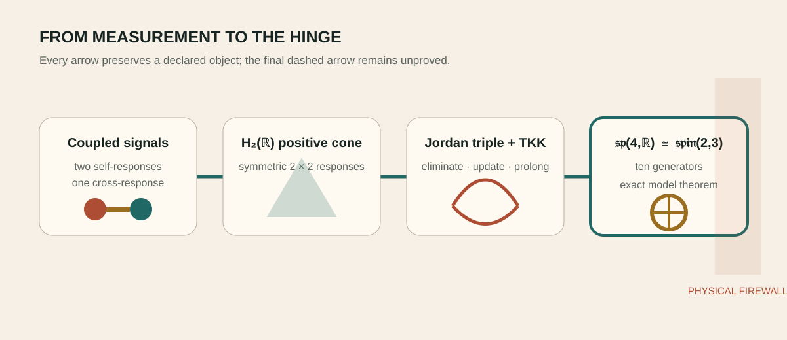

# The Jordan–Lie hinge

_One exact response-to-symmetry completion_

> **Chapter status — [✓ Established](../reading-key/status-established.md)** — Follows from declared assumptions and has an inspectable certificate.

> **Chapter function — [⊕ Integrator](../reading-key/move-integrator.md)** — joins several typed results while letting the weakest edge set the claim.

> response data → H₂(ℝ) → Peirce–Schur triple → TKK generators → 𝔰𝔭(4,ℝ) ≅ 𝔰𝔭𝔦𝔫(2,3)

_The exact mathematical spine and the physical firewall._

## What closes

> **Section status — [✓ Established](../reading-key/status-established.md)** — Follows from declared assumptions and has an inspectable certificate.

> **Research move — [⊕ Integrator](../reading-key/move-integrator.md)** — joins several typed results while letting the weakest edge set the claim.

The route to Spin(2,3) begins with positive two-face response data rather than a top-down list of low-rank coincidences. Positive two-face response data supplies H₂(ℝ); Schur elimination becomes a Jordan-triple operation; Tits–Kantor–Koecher prolongation supplies the graded generators; and the resulting ten-dimensional real Lie algebra is 𝔰𝔭(4,ℝ).

> **Expanded claim page →** [Inspect the claim’s scope, logic, verification route, boundary and sources](../details/01-the-revised-spine-what-closes-claim-1.md)

The global low-rank isomorphism then identifies Sp(4,ℝ) with Spin₀(2,3). This is the firm mathematical middle rung.

> **Expanded claim page →** [Inspect the claim’s scope, logic, verification route, boundary and sources](../details/01-the-revised-spine-what-closes-claim-2.md)

## The locally invariant carrier

The four-dimensional space is best pictured as a living carrier rather than
as spacetime. An admitted change of perspective \(M\) preserves an
antisymmetric comparison \(\Omega\):

\[
M^T\Omega M=\Omega.
\]

The thing transforms by \(M\), while its mirror face transforms by
\(M^{-T}\). The equivalent relation

\[
\Omega M=M^{-T}\Omega
\]

says that \(\Omega\) keeps the two faces mutually intelligible. We call it the
**locally invariant carrier**: the relation borne through changing local
descriptions.

“Locally invariant” does not mean globally inert. A compatible connection may
satisfy \(\nabla\Omega=0\), while transport around a loop returns a nontrivial
holonomy \(H_\gamma\ne I\) that still preserves \(\Omega\). This is how local
continuity can coexist with global phase, orientation and memory.

The four-dimensional carrier is embedded in a higher relation space through
its two-forms. Of the six directions in \(\Lambda^2V^*\), one is the invariant
\(\Omega\)-line. The remaining five primitive directions carry a symmetric
wedge pairing of signature \((2,3)\):

\[
\Lambda^2V^*=\mathbb R\Omega\oplus\Lambda^2_0V^*.
\]

This is the concrete mechanism behind
\(Sp(4,\mathbb R)\cong Spin_0(2,3)\): the orthogonal five-space records
relations among pairs of directions in the symplectic four-space. It is not a
claim of five physical spacetime coordinates.

> **Canonical development →** [The locally invariant carrier and its mirror face](../../../corpus/programmes/admissibility/admissibility_123_locally_invariant_carrier_and_mirror_face_spine.md)

## What remains open

> **Section status — [↗ Externally open](../reading-key/status-external.md)** — Needs an ingredient, calculation or observation not yet supplied by the declared model or evidence.

> **Research move — [✦ Scout](../reading-key/move-scout.md)** — opens a plausible new route or searches beyond the present ingredients.

The derivation is conditional on the carrier and generator typing. Nature has not yet selected the action, state, vacuum, quantum measure or observed quantity that would make this algebra the dynamical symmetry of a physical system.

> **Expanded claim page →** [Inspect the claim’s scope, logic, verification route, boundary and sources](../details/01-the-revised-spine-what-remains-open-claim-1.md)

## Begin with a measuring frame

> **Section status — [✓ Established](../reading-key/status-established.md)** — Follows from declared assumptions and has an inspectable certificate.

> **Research move — [⊕ Integrator](../reading-key/move-integrator.md)** — joins several typed results while letting the weakest edge set the claim.

Imagine recording two coupled signals: two voltages, two oscillator amplitudes or two stress readouts. Their self-responses and cross-response form a symmetric two-by-two table. Requiring every real combination of the signals to have nonnegative power makes that table positive. This positive cone is the everyday entrance to H₂(ℝ), the Jordan algebra of real symmetric two-by-two matrices.

> **Expanded claim page →** [Inspect the claim’s scope, logic, verification route, boundary and sources](../details/01-the-revised-spine-begin-with-a-measuring-frame-claim-1.md)

The Jordan product X∘Y=(XY+YX)/2 keeps the result symmetric even when ordinary matrix multiplication does not. It is useful when the object of interest is a state or response cone rather than an ordered sequence of operations.

> **Expanded claim page →** [Inspect the claim’s scope, logic, verification route, boundary and sources](../details/01-the-revised-spine-begin-with-a-measuring-frame-claim-2.md)

## From elimination to symmetry

> **Section status — [✓ Established](../reading-key/status-established.md)** — Follows from declared assumptions and has an inspectable certificate.

> **Research move — [⇄ Translator](../reading-key/move-translator.md)** — moves a structure between mathematical, physical or ordinary languages.

When an internal degree of freedom is removed from a coupled quadratic system, the effective response is a Schur complement. Repeating that operation produces the same triple combination that appears in Jordan theory. The Tits–Kantor–Koecher construction then packages translations, linear transformations and their opposites into a graded Lie algebra.

> **Expanded claim page →** [Inspect the claim’s scope, logic, verification route, boundary and sources](../details/01-the-revised-spine-from-elimination-to-symmetry-claim-1.md)

For the declared carrier, the closure is ten-dimensional 𝔰𝔭(4,ℝ). This algebra preserves the locally invariant oriented-area comparison \(\Omega\) on four real carrier coordinates, pairing each direct action with its mirror face. Its induced action on the five primitive two-form relations preserves a signature-\((2,3)\) wedge form. A standard low-rank isomorphism identifies its connected group with Spin₀(2,3), the double cover of the identity component of SO(2,3).

> **Expanded claim page →** [Inspect the claim’s scope, logic, verification route, boundary and sources](../details/01-the-revised-spine-from-elimination-to-symmetry-claim-2.md)

## Why ten generators are a real gate

> **Section status — [✓ Established](../reading-key/status-established.md)** — Follows from declared assumptions and has an inspectable certificate.

> **Research move — [⌕ Auditor](../reading-key/move-auditor.md)** — checks assumptions, certificates, counterexamples and stopping rules.

Four real coordinates do not automatically imply 𝔰𝔭(4,ℝ). A pair of ordinary oscillators can explore only a three-generator squeezing/rotation subalgebra. Reaching ten requires independently available anisotropies and shears. Generator rank is therefore a kill test: if commutators close at three, the model is a lower-rank control, not hidden full Spin(2,3).

> **Expanded claim page →** [Inspect the claim’s scope, logic, verification route, boundary and sources](../details/01-the-revised-spine-why-ten-generators-are-a-real-gate-claim-1.md)

## Algebra is not yet spacetime

> **Section status — [↗ Externally open](../reading-key/status-external.md)** — Needs an ingredient, calculation or observation not yet supplied by the declared model or evidence.

> **Research move — [⌕ Auditor](../reading-key/move-auditor.md)** — checks assumptions, certificates, counterexamples and stopping rules.

A symmetry can act on response coordinates without acting on physical events. Calling the response cone spacetime would require a Lorentzian state space, causal localization, a physical inner product and a map to measured rods and clocks. The current result establishes an exact algebraic hinge and deliberately stops before that interpretation.

> **Expanded claim page →** [Inspect the claim’s scope, logic, verification route, boundary and sources](../details/01-the-revised-spine-algebra-is-not-yet-spacetime-claim-1.md)

## Chapter sources

- [1023_the_gaussian_gram_selector_is_the_h2r_jordan_logdet_barrier_and_a_peirce_slice_of_the_rank_three_cubic.md](../../../corpus/claims/1000-1099/1023_the_gaussian_gram_selector_is_the_h2r_jordan_logdet_barrier_and_a_peirce_slice_of_the_rank_three_cubic.md)
- [1058_a_three_generator_jordan_furey_recursion_closes_all_of_sp4_but_requires_the_furey_channel_rotation_as_a_continuous_flow.md](../../../corpus/claims/1000-1099/1058_a_three_generator_jordan_furey_recursion_closes_all_of_sp4_but_requires_the_furey_channel_rotation_as_a_continuous_flow.md)
- [1282_the_graph_to_spin23_lane_is_internally_exhausted_at_conditional_response_symmetry_not_spacetime.md](../../../corpus/claims/1200-1299/1282_the_graph_to_spin23_lane_is_internally_exhausted_at_conditional_response_symmetry_not_spacetime.md)

---

[← The admissibility frontier](08-admissibility-frontier.md) · [Contents](../README.md) · [One carrier, two faces, three relations →](02-one-carrier-two-faces-three-relations.md)
