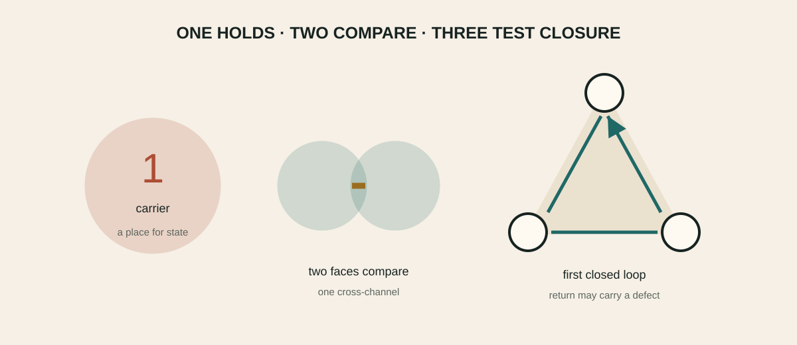

# One carrier, two faces, three relations

_Why three is meaningful_

> **Chapter status — [✓ Established](../reading-key/status-established.md)** — Follows from declared assumptions and has an inspectable certificate.

> **Chapter function — [⌖ Cartographer](../reading-key/move-cartographer.md)** — maps territory, distinctions, dependencies and interfaces.

_One holds, two compare, three can fail to close._

## The smallest relational closure

> **Section status — [✓ Established](../reading-key/status-established.md)** — Follows from declared assumptions and has an inspectable certificate.

> **Research move — [⌖ Cartographer](../reading-key/move-cartographer.md)** — maps territory, distinctions, dependencies and interfaces.

Two faces define a comparison, but a third relation is the first place where local pairwise consistency can fail around a loop. This is why the gear intuition becomes mathematically meaningful at three: not because the universe is literally geared, but because an odd cycle detects a return defect invisible on a single edge.

> **Expanded claim page →** [Inspect the claim’s scope, logic, verification route, boundary and sources](../details/02-one-carrier-two-faces-three-relations-the-smallest-relational-closure-claim-1.md)

The same grammar appears in two-port response matrices, Peirce off-diagonal spaces, placement triangles and three-edge Wilson data. What is shared is a typed relational pattern, not an identity of physical mechanisms.

> **Expanded claim page →** [Inspect the claim’s scope, logic, verification route, boundary and sources](../details/02-one-carrier-two-faces-three-relations-the-smallest-relational-closure-claim-2.md)

## Jordan recursion

> **Section status — [✓ Established](../reading-key/status-established.md)** — Follows from declared assumptions and has an inspectable certificate.

> **Research move — [⌖ Cartographer](../reading-key/move-cartographer.md)** — maps territory, distinctions, dependencies and interfaces.

For block-positive response matrices, eliminating an interior degree of freedom produces a Schur complement. Written in Jordan language, the correction is a triple operation. Repeated elimination therefore supplies a concrete meaning for Jordan-triple recursion: local consistency under composition.

> **Expanded claim page →** [Inspect the claim’s scope, logic, verification route, boundary and sources](../details/02-one-carrier-two-faces-three-relations-jordan-recursion-claim-1.md)

## Why two is comparison and three is consistency

> **Section status — [◎ Interpretive map](../reading-key/status-interpretive.md)** — Organizes thought or workflow but is not evidence for a physical claim.

> **Research move — [⇄ Translator](../reading-key/move-translator.md)** — moves a structure between mathematical, physical or ordinary languages.

Two rulers can disagree, but the disagreement is only pairwise. Add a third ruler and one may compare 1 with 2, 2 with 3, and 3 back with 1. The final comparison can fail to return to the starting convention. Three is therefore the smallest cycle that can store a relational defect.

> **Expanded claim page →** [Inspect the claim’s scope, logic, verification route, boundary and sources](../details/02-one-carrier-two-faces-three-relations-why-two-is-comparison-and-three-is-consistency-claim-1.md)

This is the grounded meaning of the programme's recurring three. It is not a numerological claim that every appearance of three has one cause. The number can count edges of a minimal loop, components of a response cone, families, or a bundle degree; a valid bridge must say which object is being counted and which map preserves the count.

> **Expanded claim page →** [Inspect the claim’s scope, logic, verification route, boundary and sources](../details/02-one-carrier-two-faces-three-relations-why-two-is-comparison-and-three-is-consistency-claim-2.md)

## Faces and the off-diagonal channel

> **Section status — [✓ Established](../reading-key/status-established.md)** — Follows from declared assumptions and has an inspectable certificate.

> **Research move — [⌖ Cartographer](../reading-key/move-cartographer.md)** — maps territory, distinctions, dependencies and interfaces.

A two-by-two response has two diagonal entries—its faces—and one off-diagonal channel connecting them. Positivity constrains the channel by the two faces, just as the diagonal length of a rectangle is constrained by its sides. Peirce decomposition is the algebraic name for separating those diagonal and connecting pieces.

> **Expanded claim page →** [Inspect the claim’s scope, logic, verification route, boundary and sources](../details/02-one-carrier-two-faces-three-relations-faces-and-the-off-diagonal-channel-claim-1.md)

The Schur complement then describes what the outside observer sees after an internal face is hidden. This makes the recursion operational: eliminate, update the response, and ask which structure survives.

> **Expanded claim page →** [Inspect the claim’s scope, logic, verification route, boundary and sources](../details/02-one-carrier-two-faces-three-relations-faces-and-the-off-diagonal-channel-claim-2.md)

## Three relations do not select an orientation

> **Section status — [⊘ Obstruction / no-go](../reading-key/status-obstruction.md)** — A stated candidate class or identification has been ruled out under explicit assumptions.

> **Research move — [⌕ Auditor](../reading-key/move-auditor.md)** — checks assumptions, certificates, counterexamples and stopping rules.

A triangle can be traversed clockwise or anticlockwise. The unoriented graph does not choose between them. This simple fact reappears at the selector gate: symmetric endpoint data cannot select a non-fixed orientation. A boundary normal, historical preparation, complex phase reference or other odd datum must be physically supplied and locally coupled.

> **Expanded claim page →** [Inspect the claim’s scope, logic, verification route, boundary and sources](../details/02-one-carrier-two-faces-three-relations-three-relations-do-not-select-an-orientation-claim-1.md)

## The graph result

> **Section status — [◇ Conditional](../reading-key/status-conditional.md)** — Works after a named field, coefficient, boundary condition or control is supplied.

> **Research move — [⚒ Builder](../reading-key/move-builder.md)** — constructs a model, mechanism, calculation, protocol or intervention.

A scaled cycle graph canonically isolates a real first-harmonic plane under refinement, but leaves an O(2) basis ambiguity. Symmetric controls generate only the common-oscillator 𝔰𝔭(2,ℝ). Three addressed anisotropies can generate full 𝔰𝔭(4,ℝ), but the addresses are control data, not consequences of the cycle. The graph lane therefore reaches conditional response symmetry, not emergent spacetime.

> **Expanded claim page →** [Inspect the claim’s scope, logic, verification route, boundary and sources](../details/02-one-carrier-two-faces-three-relations-the-graph-result-claim-1.md)

## The terminal is a return class

The sequence does not end at three. Three relations close the first diagnostic
loop and return to the carrier:

\[
 1\longrightarrow2\longrightarrow3\longrightarrow1'.
\]

The prime matters. The returned carrier may be equivalent to the original
under a declared gauge, basis or detector quotient while retaining phase,
orientation, memory, entropy production or another path residue. Repetition
therefore forms a helix rather than an immobile point.

The corpus's strongest terminal is a **stable reconstructible return class**:
the process returns to the same declared equivalence class, contracts
transverse perturbations, preserves the residue needed to distinguish its
mechanism, and predicts held-out records. A fixed point is the special case
with one-step return and zero residue. Limit cycles, holonomies, metastable
attractors and renormalization fixed shapes are equally admissible when their
return depth and detector are stated.

This is why “spin deeper and deeper” need not mean failure to converge. The
microscopic state may keep moving while the law of admissible transport
stabilizes.

> **Corpus synthesis →** [Wave 7.230: the terminal is a stable reconstructible return class](../../../corpus/programmes/frontier/wave-7/frontier_wave7_230_the_terminal_is_a_stable_reconstructible_return_class.md)

## Chapter sources

- [202_peirce_schur_triple_recursion_to_spin23.md](../../../corpus/claims/0200-0299/202_peirce_schur_triple_recursion_to_spin23.md)
- [1280_a_cycle_graph_selects_a_refinement_stable_real_two_mode_plane_but_not_its_orientation.md](../../../corpus/claims/1200-1299/1280_a_cycle_graph_selects_a_refinement_stable_real_two_mode_plane_but_not_its_orientation.md)
- [1281_full_sp4_closure_requires_addressed_anisotropy_which_is_control_data_not_cycle_symmetry.md](../../../corpus/claims/1200-1299/1281_full_sp4_closure_requires_addressed_anisotropy_which_is_control_data_not_cycle_symmetry.md)

---

[← The Jordan–Lie hinge](01-the-revised-spine.md) · [Contents](../README.md) · [The projective loop →](03-projective-loop.md)
