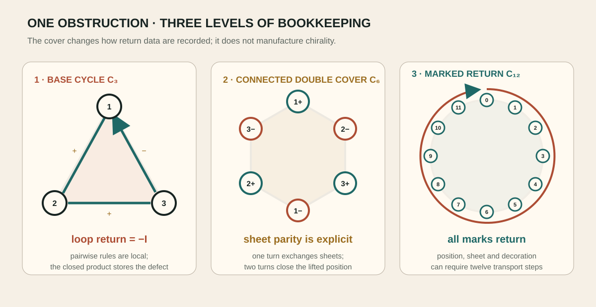
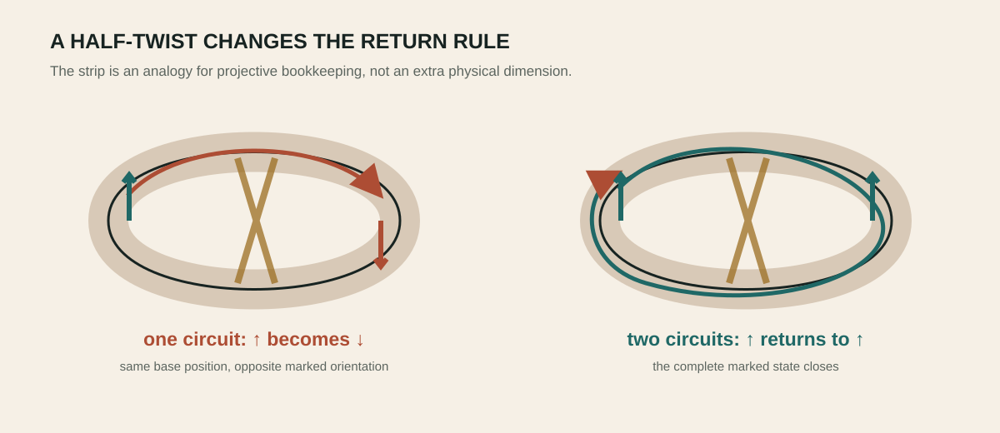
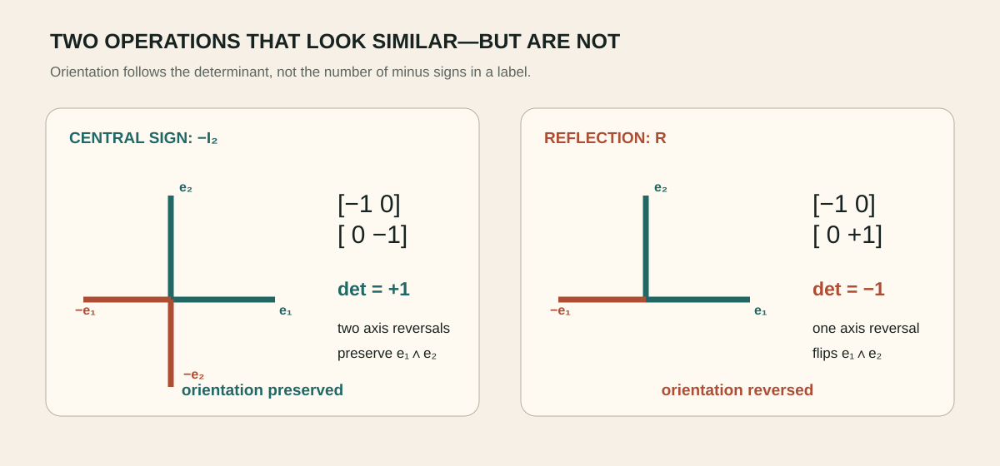
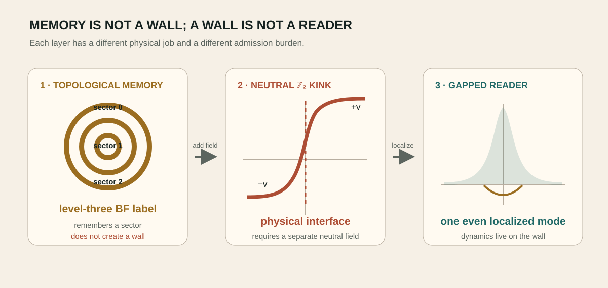

# The projective loop

_Möbius intuition, double covers and central sign_

> **Chapter status — [⊘ Obstruction / no-go](../reading-key/status-obstruction.md)** — A stated candidate class or identification has been ruled out under explicit assumptions.

> **Chapter function — [⌕ Auditor](../reading-key/move-auditor.md)** — checks assumptions, certificates, counterexamples and stopping rules.

## The exact result

> **Section status — [✓ Established](../reading-key/status-established.md)** — Follows from declared assumptions and has an inspectable certificate.

> **Research move — [⌕ Auditor](../reading-key/move-auditor.md)** — checks assumptions, certificates, counterexamples and stopping rules.

An odd three-relation cycle can fail to return on the base configuration while closing on a connected double cover. The placement triangle lifts to a six-cycle, and coherent transport can require twelve steps before every marked datum returns.

> **Expanded claim page →** [Inspect the claim’s scope, logic, verification route, boundary and sources](../details/03-projective-loop-the-exact-result-claim-1.md)

This is the mathematically disciplined form of the twisted odd-gear intuition: the obstruction lives in projective lifting and holonomy.

> **Expanded claim page →** [Inspect the claim’s scope, logic, verification route, boundary and sources](../details/03-projective-loop-the-exact-result-claim-2.md)

_The base triangle stores the obstruction; the six-cycle makes sheet parity single-valued; the twelve-step marked lift returns every decoration._

## The reversal

> **Section status — [⊘ Obstruction / no-go](../reading-key/status-obstruction.md)** — A stated candidate class or identification has been ruled out under explicit assumptions.

> **Research move — [⌕ Auditor](../reading-key/move-auditor.md)** — checks assumptions, certificates, counterexamples and stopping rules.

The central return −I preserves determinant orientation. It therefore cannot simply be renamed chirality or identified with a Pfaffian-sheet reversal. The negative result is productive: it tells the programme that orientation needs an independently odd datum.

> **Expanded claim page →** [Inspect the claim’s scope, logic, verification route, boundary and sources](../details/03-projective-loop-the-reversal-claim-1.md)

## A familiar twisted-loop picture

> **Section status — [◎ Interpretive map](../reading-key/status-interpretive.md)** — Organizes thought or workflow but is not evidence for a physical claim.

> **Research move — [⌕ Auditor](../reading-key/move-auditor.md)** — checks assumptions, certificates, counterexamples and stopping rules.

Write an arrow on a strip of paper, give the strip a half twist, and join the ends. After one circuit the arrow returns reversed; after two it returns fully. A projective double cover records this without pretending that the paper moved through an extra physical dimension.

> **Expanded claim page →** [Inspect the claim’s scope, logic, verification route, boundary and sources](../details/03-projective-loop-a-familiar-twisted-loop-picture-claim-1.md)

The programme's three-placement loop behaves similarly. Local transitions can be consistent while their product returns a central sign. Lifting the triangle to a six-cycle makes the sign bookkeeping single-valued, and a twelve-step marked transport can return every decoration.

> **Expanded claim page →** [Inspect the claim’s scope, logic, verification route, boundary and sources](../details/03-projective-loop-a-familiar-twisted-loop-picture-claim-2.md)

_A half-twist needs two circuits to return both position and arrow orientation._

## Central sign versus handedness

> **Section status — [⊘ Obstruction / no-go](../reading-key/status-obstruction.md)** — A stated candidate class or identification has been ruled out under explicit assumptions.

> **Research move — [⌕ Auditor](../reading-key/move-auditor.md)** — checks assumptions, certificates, counterexamples and stopping rules.

Multiplying every vector by minus one changes its sign but preserves the orientation of an even-dimensional frame. Handedness instead changes under a reflection with negative determinant. This is why a central -I holonomy cannot simply be called chirality.

> **Expanded claim page →** [Inspect the claim’s scope, logic, verification route, boundary and sources](../details/03-projective-loop-central-sign-versus-handedness-claim-1.md)

The distinction is not pedantry. A physical selector must couple to something that actually changes under the proposed exchange. If the candidate datum is even, no amount of suggestive language makes it an orientation source.

> **Expanded claim page →** [Inspect the claim’s scope, logic, verification route, boundary and sources](../details/03-projective-loop-central-sign-versus-handedness-claim-2.md)

_Central sign reversal and orientation reversal are different operations: det(−I₂)=+1, while a reflection has determinant −1._

## From topology to a defect

> **Section status — [◇ Conditional](../reading-key/status-conditional.md)** — Works after a named field, coefficient, boundary condition or control is supplied.

> **Research move — [⚒ Builder](../reading-key/move-builder.md)** — constructs a model, mechanism, calculation, protocol or intervention.

A topological label can remember how a loop was prepared, but a localized laboratory mode also needs a place to live. The charge-three Higgs sector has a precise level-three BF limit, yet its apparent phase vacua are gauge copies and cannot make a domain wall. Adding a neutral ℤ₂ field supplies an explicit kink and one localized even bosonic reader.

> **Expanded claim page →** [Inspect the claim’s scope, logic, verification route, boundary and sources](../details/03-projective-loop-from-topology-to-a-defect-claim-1.md)

This cleanly separates memory from hardware: BF theory carries the sector label; the gapped reader carries non-topological dynamics; and the wall's origin remains an external microscopic question.

> **Expanded claim page →** [Inspect the claim’s scope, logic, verification route, boundary and sources](../details/03-projective-loop-from-topology-to-a-defect-claim-2.md)

_Memory, wall and reader are three different jobs; the latter two require additional physical structure._
## Chapter sources

- [994_the_three_placement_triangle_has_a_z2_sideband_frustration_and_requires_path_dependence_or_a_double_cover.md](../../../corpus/claims/0900-0999/994_the_three_placement_triangle_has_a_z2_sideband_frustration_and_requires_path_dependence_or_a_double_cover.md)
- [1233_charge_three_abelian_higgs_reduces_conditionally_to_level_three_bf_and_a_gapped_unit_charge_reader_can_coexist_only_as_non_topological_memory.md](../../../corpus/claims/1200-1299/1233_charge_three_abelian_higgs_reduces_conditionally_to_level_three_bf_and_a_gapped_unit_charge_reader_can_coexist_only_as_non_topological_memory.md)
- [1292_a_neutral_z2_kink_is_the_minimal_defect_origin_and_one_even_charge_one_boson_localizes_without_mirror_doubling.md](../../../corpus/claims/1200-1299/1292_a_neutral_z2_kink_is_the_minimal_defect_origin_and_one_even_charge_one_boson_localizes_without_mirror_doubling.md)

---

[← One carrier, two faces, three relations](02-one-carrier-two-faces-three-relations.md) · [Contents](../README.md) · [The Furey interface →](04-furey-interface.md)
