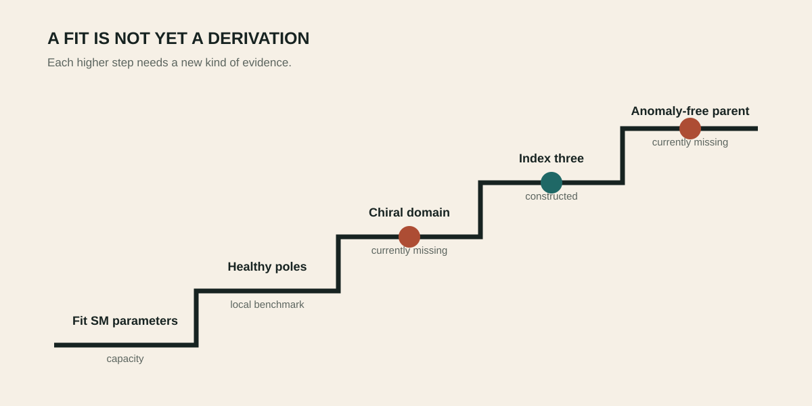

# The Standard-Model seam

_Mediator completion and the third edge_

> **Chapter status — [↗ Externally open](../reading-key/status-external.md)** — Needs an ingredient, calculation or observation not contained in the current corpus.

> **Chapter function — [⌕ Auditor](../reading-key/move-auditor.md)** — checks assumptions, certificates, counterexamples and stopping rules.

_Compatibility, chirality, family count and anomaly cancellation are separate gates._

## The attractive construction

> **Section status — [◇ Conditional](../reading-key/status-conditional.md)** — Works after a named field, coefficient, boundary condition or control is supplied.

> **Research move — [⌕ Auditor](../reading-key/move-auditor.md)** — checks assumptions, certificates, counterexamples and stopping rules.

The minimal Standard-Model field completion points toward dimension-six S₁ exchange operators. They reproduce the two desired crossed arms with the required relative structure.

> **Expanded claim page →** [Inspect the claim’s scope, logic, verification route, boundary and sources](../details/05-standard-model-seam-the-attractive-construction-claim-1.md)

## The uncomfortable edge

> **Section status — [⊘ Obstruction / no-go](../reading-key/status-obstruction.md)** — A stated candidate class or identification has been ruled out under explicit assumptions.

> **Research move — [⌕ Auditor](../reading-key/move-auditor.md)** — checks assumptions, certificates, counterexamples and stopping rules.

The same mediator generically closes a triangle and generates a third Wilson edge. One copy is rank-obstructed; copies preserving the same positive Clebsch orientation do not cancel it. A pure star must therefore be derived by a new incidence rule, involution or boundary mechanism—or abandoned.

> **Expanded claim page →** [Inspect the claim’s scope, logic, verification route, boundary and sources](../details/05-standard-model-seam-the-uncomfortable-edge-claim-1.md)

## What c, L and Y mean

> **Section status — [✓ Established](../reading-key/status-established.md)** — Follows from declared assumptions and has an inspectable certificate.

> **Research move — [⌕ Auditor](../reading-key/move-auditor.md)** — checks assumptions, certificates, counterexamples and stopping rules.

In the Standard-Model algebra su(3)c⊕su(2)L⊕u(1)Y, c labels colour, the three-way charge carried by quarks; L labels the weak interaction acting on left-handed doublets; and Y is hypercharge, the bookkeeping quantity which combines with weak isospin to give electric charge. These labels are directions in an internal measuring system, not ordinary colours, locations or heights.

> **Expanded claim page →** [Inspect the claim’s scope, logic, verification route, boundary and sources](../details/05-standard-model-seam-what-c-l-and-y-mean-claim-1.md)

The direct-sum sign means that these symmetry instructions coexist. It does not say that a larger group has already explained why nature chose them or why matter occupies its observed chiral representations.

> **Expanded claim page →** [Inspect the claim’s scope, logic, verification route, boundary and sources](../details/05-standard-model-seam-what-c-l-and-y-mean-claim-2.md)

## Fit capacity versus derivation

> **Section status — [⊘ Obstruction / no-go](../reading-key/status-obstruction.md)** — A stated candidate class or identification has been ruled out under explicit assumptions.

> **Research move — [⌕ Auditor](../reading-key/move-auditor.md)** — checks assumptions, certificates, counterexamples and stopping rules.

A sufficiently flexible effective action can reproduce Standard-Model masses and mixing parameters. That demonstrates compatibility, much as an adjustable curve can pass through many points. It does not predict the points. The current decoupling limit has ample flavour capacity, so its success is a consistency witness rather than a derivation.

> **Expanded claim page →** [Inspect the claim’s scope, logic, verification route, boundary and sources](../details/05-standard-model-seam-fit-capacity-versus-derivation-claim-1.md)

## The chiral fold obstruction

> **Section status — [↗ Externally open](../reading-key/status-external.md)** — Needs an ingredient, calculation or observation not contained in the current corpus.

> **Research move — [⌕ Auditor](../reading-key/move-auditor.md)** — checks assumptions, certificates, counterexamples and stopping rules.

A mirror turns a left glove into a right glove. Likewise, spatial reflection exchanges left- and right-handed Weyl spinors. The bosonic fold can have healthy masses and residues while the fermionic theory remains undefined, because the undoubled chiral Standard Model does not supply the same-representation partner required by the reflection.

> **Expanded claim page →** [Inspect the claim’s scope, logic, verification route, boundary and sources](../details/05-standard-model-seam-the-chiral-fold-obstruction-claim-1.md)

The next valid object is therefore not another positive bosonic spectrum. It is a declared fermion boundary domain—bag, APS/inflow, vectorlike or another explicit construction—followed by self-adjointness, gauge consistency and BRST cohomology on that same domain.

> **Expanded claim page →** [Inspect the claim’s scope, logic, verification route, boundary and sources](../details/05-standard-model-seam-the-chiral-fold-obstruction-claim-2.md)

## Three generations and the index

> **Section status — [◇ Conditional](../reading-key/status-conditional.md)** — Works after a named field, coefficient, boundary condition or control is supplied.

> **Research move — [⚒ Builder](../reading-key/move-builder.md)** — constructs a model, mechanism, calculation, protocol or intervention.

An index is a robust signed count of zero modes, rather like counting unmatched left-moving and right-moving lanes after paired lanes cancel. The selected-projector completion canonically pulls back the anticanonical line on ℂP¹ to O(3), giving Dirac index three for every spectator Standard-Model multiplet.

> **Expanded claim page →** [Inspect the claim’s scope, logic, verification route, boundary and sources](../details/05-standard-model-seam-three-generations-and-the-index-claim-1.md)

That is the programme's strongest typed bridge to three families. Its minimal local six-dimensional realization is nevertheless anomalous, and the obvious vectorlike repair restores mirror families. The bundle explains a count; it does not yet provide an acceptable parent theory.

> **Expanded claim page →** [Inspect the claim’s scope, logic, verification route, boundary and sources](../details/05-standard-model-seam-three-generations-and-the-index-claim-2.md)

## Chapter sources

- [1390_a_decoupling_limit_can_fit_the_standard_model_but_a6_first_fails_at_the_unconstructed_chiral_fermion_operator.md](../../../corpus/claims/1300-1399/1390_a_decoupling_limit_can_fit_the_standard_model_but_a6_first_fails_at_the_unconstructed_chiral_fermion_operator.md)
- [1450_the_o3_twisted_cp1_operator_has_exactly_three_universal_chiral_zero_modes_but_its_minimal_local_six_dimensional_parent_is_anomalous.md](../../../corpus/claims/1400-1499/1450_the_o3_twisted_cp1_operator_has_exactly_three_universal_chiral_zero_modes_but_its_minimal_local_six_dimensional_parent_is_anomalous.md)
- [1451_the_maximal_a4_action_freezes_all_bulk_poles_but_the_chiral_fold_has_no_declared_physical_state_domain.md](../../../corpus/claims/1400-1499/1451_the_maximal_a4_action_freezes_all_bulk_poles_but_the_chiral_fold_has_no_declared_physical_state_domain.md)

---

[← The Furey interface](04-furey-interface.md) · [Contents](../README.md) · [Proton safety, Pati–Salam and triality →](06-proton-safety.md)
