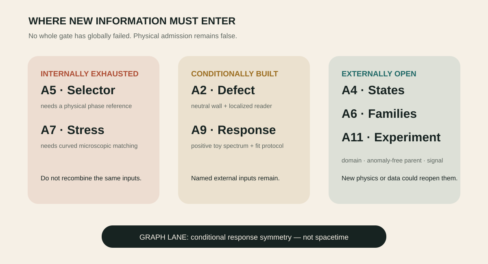

# Research frontier

_Legacy action gates, the graph lane and the current torsion-parent boundary_

> **Chapter status — [↗ Externally open](../reading-key/status-external.md)** — Needs an ingredient, calculation or observation not contained in the current corpus.

> **Chapter function — [✦ Scout](../reading-key/move-scout.md)** — opens a plausible new route or searches beyond the present ingredients.

_The terminal partition says where new information must enter._

## A2 · Derive the defect rather than insert it

> **Gate state — [◇ Conditional](../reading-key/status-conditional.md)** — Works after a named field, coefficient, boundary condition or control is supplied.

> **Needed move — [⚒ Builder](../reading-key/move-builder.md)** — constructs a model, mechanism, calculation, protocol or intervention.

**Priority:** `external-input`

**Question:** What microscopic action creates the neutral wall, its orientation and a globally compatible compact domain?

**Advance when:** One UV model produces the interface, BF parity and localized reader spectrum with no hand-selected history.

**Stop or downgrade when:** Do not keep manipulating gauge-equivalent charge-three phases as though they were disconnected vacua.

- [1233_charge_three_abelian_higgs_reduces_conditionally_to_level_three_bf_and_a_gapped_unit_charge_reader_can_coexist_only_as_non_topological_memory.md](../../../corpus/claims/1200-1299/1233_charge_three_abelian_higgs_reduces_conditionally_to_level_three_bf_and_a_gapped_unit_charge_reader_can_coexist_only_as_non_topological_memory.md)
- [1292_a_neutral_z2_kink_is_the_minimal_defect_origin_and_one_even_charge_one_boson_localizes_without_mirror_doubling.md](../../../corpus/claims/1200-1299/1292_a_neutral_z2_kink_is_the_minimal_defect_origin_and_one_even_charge_one_boson_localizes_without_mirror_doubling.md)

## A4 · Define the chiral physical-state domain

> **Gate state — [↗ Externally open](../reading-key/status-external.md)** — Needs an ingredient, calculation or observation not contained in the current corpus.

> **Needed move — [⚒ Builder](../reading-key/move-builder.md)** — constructs a model, mechanism, calculation, protocol or intervention.

**Priority:** `stop-everything`

**Question:** What Lorentz- and gauge-compatible fermion domain replaces the bosonic reflection fold?

**Advance when:** A self-adjoint operator, lower bound, BRST cohomology and positive residues are computed on the same declared domain.

**Stop or downgrade when:** A positive bosonic benchmark does not establish unitarity of the chiral theory.

- [1451_the_maximal_a4_action_freezes_all_bulk_poles_but_the_chiral_fold_has_no_declared_physical_state_domain.md](../../../corpus/claims/1400-1499/1451_the_maximal_a4_action_freezes_all_bulk_poles_but_the_chiral_fold_has_no_declared_physical_state_domain.md)

## A5 · Supply a physical phase reference

> **Gate state — [■ Internally exhausted](../reading-key/status-exhausted.md)** — Rearranging the present ingredients no longer addresses the missing datum.

> **Needed move — [◉ Witness](../reading-key/move-witness.md)** — retains observation, preparation history, stakes and situated evidence.

**Priority:** `external-input`

**Question:** What measured or history-bearing charge-minus-two datum chooses the sterile phase axis and locks it locally to the charged carrier?

**Advance when:** A gauge-complete local operator selects the whole orientation without target-dependent convention.

**Stop or downgrade when:** Searches among already-audited symmetric data are exhausted.

- [1395_no_declared_cp_boundary_z3_flavor_or_index_datum_fixes_the_a5_sterile_phase_reference.md](../../../corpus/claims/1300-1399/1395_no_declared_cp_boundary_z3_flavor_or_index_datum_fixes_the_a5_sterile_phase_reference.md)

## A6 · Make index three anomaly-free and mirror-free

> **Gate state — [↗ Externally open](../reading-key/status-external.md)** — Needs an ingredient, calculation or observation not contained in the current corpus.

> **Needed move — [⚒ Builder](../reading-key/move-builder.md)** — constructs a model, mechanism, calculation, protocol or intervention.

**Priority:** `stop-everything`

**Question:** Can a local or spectral real structure retain three complete chiral families while cancelling the full higher-dimensional anomaly polynomial?

**Advance when:** The construction supplies sterile pairing, cancels local and global anomalies and has no independent mirror kernel.

**Stop or downgrade when:** The integer three and O(3) bundle are not by themselves a physical family derivation.

- [1450_the_o3_twisted_cp1_operator_has_exactly_three_universal_chiral_zero_modes_but_its_minimal_local_six_dimensional_parent_is_anomalous.md](../../../corpus/claims/1400-1499/1450_the_o3_twisted_cp1_operator_has_exactly_three_universal_chiral_zero_modes_but_its_minimal_local_six_dimensional_parent_is_anomalous.md)

## A7 · Match the stress operator in curved microscopic theory

> **Gate state — [■ Internally exhausted](../reading-key/status-exhausted.md)** — Rearranging the present ingredients no longer addresses the missing datum.

> **Needed move — [⇄ Translator](../reading-key/move-translator.md)** — moves a structure between mathematical, physical or ordinary languages.

**Priority:** `external-input`

**Question:** Which renormalization condition fixes improvement, contact terms, displacement operators and the common physical probe?

**Advance when:** One completed action predicts the renormalized stress vertex and port map at a stated scale.

**Stop or downgrade when:** The full third matrix direction must remain secondary while its improvement dependence is unfixed.

- [1396_no_current_principle_predicts_the_reader_curvature_coupling_so_only_the_traceless_threshold_is_scheme_robust.md](../../../corpus/claims/1300-1399/1396_no_current_principle_predicts_the_reader_curvature_coupling_so_only_the_traceless_threshold_is_scheme_robust.md)

## A9 · Predict a causal interacting spectrum

> **Gate state — [◇ Conditional](../reading-key/status-conditional.md)** — Works after a named field, coefficient, boundary condition or control is supplied.

> **Needed move — [⚒ Builder](../reading-key/move-builder.md)** — constructs a model, mechanism, calculation, protocol or intervention.

**Priority:** `highest`

**Question:** What microscopic Hamiltonian predicts the sector-dependent pole, residue, linewidth and band support?

**Advance when:** A causal positive spectral density survives disorder, calibration and held-out sector labels with the port fixed in advance.

**Stop or downgrade when:** A static covariance, scalar linewidth or phenomenological curve is not an interacting response derivation.

- [1452_the_scheme_invariant_a11_experiment_is_a_calibrated_spectral_pole_and_band_contrast_with_a_device_prediction_gate.md](../../../corpus/claims/1400-1499/1452_the_scheme_invariant_a11_experiment_is_a_calibrated_spectral_pole_and_band_contrast_with_a_device_prediction_gate.md)
- [1454_the_zenodo_chern_quadrature_reproduces_but_is_not_the_exact_sigma_z_lindblad_hall_response.md](../../../corpus/claims/1400-1499/1454_the_zenodo_chern_quadrature_reproduces_but_is_not_the_exact_sigma_z_lindblad_hall_response.md)

## A11 · Turn sensitivity into a physical test

> **Gate state — [↗ Externally open](../reading-key/status-external.md)** — Needs an ingredient, calculation or observation not contained in the current corpus.

> **Needed move — [⚒ Builder](../reading-key/move-builder.md)** — constructs a model, mechanism, calculation, protocol or intervention.

**Priority:** `highest`

**Question:** What device model predicts an absolute signal before data are unblinded, and can a protected ℤ₃ sector actually be prepared?

**Advance when:** A powered experiment tests a preregistered effect size with independently verified sector algebra and scaling.

**Stop or downgrade when:** Three settings of a continuous U(1) control are not protected ℤ₃ sectors.

- [1452_the_scheme_invariant_a11_experiment_is_a_calibrated_spectral_pole_and_band_contrast_with_a_device_prediction_gate.md](../../../corpus/claims/1400-1499/1452_the_scheme_invariant_a11_experiment_is_a_calibrated_spectral_pole_and_band_contrast_with_a_device_prediction_gate.md)

## GRAPH · Derive the missing anisotropies

> **Gate state — [◇ Conditional](../reading-key/status-conditional.md)** — Works after a named field, coefficient, boundary condition or control is supplied.

> **Needed move — [⚒ Builder](../reading-key/move-builder.md)** — constructs a model, mechanism, calculation, protocol or intervention.

**Priority:** `external-input`

**Question:** Can an action generate the addressed controls that enlarge the natural 𝔰𝔭(2,ℝ) response symmetry to all ten generators of 𝔰𝔭(4,ℝ)?

**Advance when:** Orientation and anisotropy arise dynamically and ten-generator closure survives loss, disorder and refinement.

**Stop or downgrade when:** A four-real carrier or conformally symplectic flow alone is not full Spin(2,3).

- [1455_the_corrected_octonionic_two_branch_flow_has_an_exact_cp_lindblad_completion_and_a_three_coordinate_lorentz_cone_but_not_full_spin23.md](../../../corpus/claims/1400-1499/1455_the_corrected_octonionic_two_branch_flow_has_an_exact_cp_lindblad_completion_and_a_three_coordinate_lorentz_cone_but_not_full_spin23.md)
- [1282_the_graph_to_spin23_lane_is_internally_exhausted_at_conditional_response_symmetry_not_spacetime.md](../../../corpus/claims/1200-1299/1282_the_graph_to_spin23_lane_is_internally_exhausted_at_conditional_response_symmetry_not_spacetime.md)

## TORSION-UV · Construct the protected torsion parent

> **Gate state — [↗ Externally open](../reading-key/status-external.md)** — Needs an ingredient, calculation or observation not contained in the current corpus.

> **Needed move — [⚒ Builder](../reading-key/move-builder.md)** — constructs a model, mechanism, calculation, protocol or intervention.

**Priority:** `highest`

**Question:** Which complete microscopic theory contains a nondegenerate vacuum, a positive independent zero-minus connection pole and a protected normalized axial-current coupling?

**Advance when:** One action passes the reality, constraint, spectrum, radiative-protection and threshold-matching gates without importing the answer as a free coefficient.

**Stop or downgrade when:** Another symmetry label, projector or quadratic parameter scan cannot replace the missing model.

- [1788_all_finite_escapes_from_the_minimal_connection_parent_now_end_at_new_model_construction.md](../../../corpus/claims/1700-1799/1788_all_finite_escapes_from_the_minimal_connection_parent_now_end_at_new_model_construction.md)

## Chapter sources

- [1453_genuine_exhaustion_leaves_no_untyped_internal_work_but_seven_named_external_or_conditional_frontiers.md](../../../corpus/claims/1400-1499/1453_genuine_exhaustion_leaves_no_untyped_internal_work_but_seven_named_external_or_conditional_frontiers.md)
- [1456_the_two_zenodo_preprints_strengthen_response_controls_but_do_not_change_the_terminal_gate_partition.md](../../../corpus/claims/1400-1499/1456_the_two_zenodo_preprints_strengthen_response_controls_but_do_not_change_the_terminal_gate_partition.md)
- [1624_the_reopened_mass_gap_action_and_shared_scale_programme_reaches_five_irreducible_gates.md](../../../corpus/claims/1600-1699/1624_the_reopened_mass_gap_action_and_shared_scale_programme_reaches_five_irreducible_gates.md)
- [1788_all_finite_escapes_from_the_minimal_connection_parent_now_end_at_new_model_construction.md](../../../corpus/claims/1700-1799/1788_all_finite_escapes_from_the_minimal_connection_parent_now_end_at_new_model_construction.md)

---

[← Result and reversal ledger](08-result-ledger.md) · [Contents](../README.md) · [Provenance and reading map →](10-provenance-and-reading-map.md)
