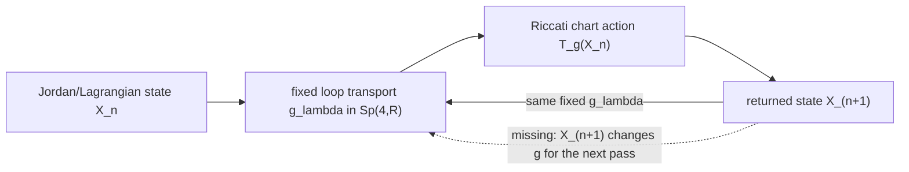

# The Natural Spin(2,3) Riccati Return Is Fixed Transport, Not Yet a Feedback Bifurcation

**Date:** 19 October 2026  
**Branches:** generative dynamics, Jordan--Riccati return, Möbius covers, typed TRO closure, state-dependent holonomy  
**Claim status:** exact return-map identification plus negative feedback gate; nonlinear bifurcation remains conditional  
**Certificate:** [verify_current_spin23_returns_have_no_derived_period_doubling.mjs](../../../verification/verify/verify_current_spin23_returns_have_no_derived_period_doubling.mjs)

## Executive result

The corpus does contain a natural Spin(2,3)-specific return operation. A symplectic transport

\[
g_\lambda=
\begin{pmatrix}
A_\lambda&B_\lambda\\
C_\lambda&D_\lambda
\end{pmatrix}
\in Sp(4,\mathbb R)
\]

acts on a Lagrangian graph \(p=Xq\), with \(X\in H_2(\mathbb R)\), by the fractional-linear Riccati map

\[
\boxed{
T_{g_\lambda}(X)
=(C_\lambda+D_\lambda X)
(A_\lambda+B_\lambda X)^{-1}.
}
\]

This is the discrete return associated with the already-derived continuous Jordan--Riccati equation

\[
\dot X=C-A^TX-XA-XBX.
\]

It is therefore not imported from the logistic map. It comes directly from the action of

\[
Sp(4,\mathbb R)\cong Spin_0(2,3)
\]

on its Lagrangian/Jordan chart.

However, the current corpus supplies \(g_\lambda\) as a fixed transport. Consequently

\[
\boxed{
T_{g_\lambda}^{,n}=T_{g_\lambda^n}.
}
\]

The apparent nonlinearity is the coordinate expression of a fixed linear symplectic action. The returned state does not alter the generator of its next passage. This is ordinary repeated transport, not the feedback required for a Feigenbaum cascade.

The present verdict is therefore:

\[
\boxed{
\text{natural return map: derived;}
\qquad
\text{state-dependent feedback and period doubling: not derived.}
}
\]

## 1. The return map already present in the corpus

Let

\[
\binom{q'}{p'}
=g\binom{q}{p}
=
\begin{pmatrix}A&B\\C&D\end{pmatrix}
\binom{q}{p}.
\]

On the graph \(p=Xq\),

\[
q'=(A+BX)q,
\qquad
p'=(C+DX)q.
\]

Whenever \(A+BX\) is invertible, the transported graph is

\[
p'=X'q',
\qquad
X'=(C+DX)(A+BX)^{-1}.
\]

The symplectic identities guarantee that symmetric \(X\) is mapped to symmetric \(X'\). Thus

\[
T_g:H_2(\mathbb R)\dashrightarrow H_2(\mathbb R)
\]

is the canonical local return map on the Jordan carrier. Its poles mark chart crossings, not automatically physical divergences; another Lagrangian chart may continue the orbit.

The composition law is exact:

\[
T_g\circ T_h=T_{gh}
\]

for the stated convention. Hence repeated traversal of one fixed loop gives \(T_{g^n}\).

## 2. Explicit return-map diagram

What is missing is not a return. It is the feedback arrow

\[
X_n\longmapsto g_\lambda[X_n].
\]

Without that arrow, the loop transports a state but is not modified by the transported state.

## 3. Exact scalar-slice flip obstruction

The simplest invariant slice takes

\[
X=xI_2,
\qquad
A=aI_2,
\quad B=bI_2,
\quad C=cI_2,
\quad D=dI_2,
\]

with

\[
ad-bc=1.
\]

Then

\[
x_{n+1}=f(x_n)=\frac{c+dx_n}{a+bx_n}.
\]

Its derivative is

\[
f'(x)=\frac{ad-bc}{(a+bx)^2}
=\frac1{(a+bx)^2}>0
\]

away from the chart pole. A conventional flip bifurcation requires a fixed-point multiplier to cross \(-1\). That cannot occur on this real scalar symplectic slice.

For the explicit hyperbolic element

\[
\begin{pmatrix}a&b\\c&d\end{pmatrix}
=
\begin{pmatrix}2&1\\1&1\end{pmatrix},
\qquad
f(x)=\frac{1+x}{2+x},
\]

the fixed equation is

\[
x^2+x-1=0.
\]

The equation \(f^2(x)=x\) reduces to the same polynomial, so this map has no distinct real two-cycle. The positive fixed point

\[
x_*=\frac{\sqrt5-1}{2}
\]

has

\[
0<f'(x_*)<1.
\]

This is a bounded exact no-go. It does not prove that every possible state-dependent matrix Riccati system is non-chaotic. It proves that the minimal fixed symplectic return does not supply the first flip even on its most natural scalar reduction.

## 4. Audit of the named generative constructions

| Corpus mechanism | Natural repeated operation | What iteration does | Feedback present? | Bifurcation status |
|---|---|---|---|---|
| weighted Furey root | \(\theta\mapsto\theta+\pi\) | \(P\mapsto P\), \(A\mapsto-A\) | no | covering-period multiplication only |
| KO-6 oriented relation cycles | fixed \(C_3\), \(C_6\), or \(D_3\) action | finite permutation orbit | no | finite holonomy only |
| overlapping \(H_2\) wheels | take unital Jordan closure | reaches \(H_3\) and then stabilizes | no | idempotent algebraic closure |
| typed two-spoke TRO | \(\{x,y,z\}\) inside the row space | remains in the same typed relation module | no endogenous generator update | closure, not instability |
| canonical TRO self-triple | \(x\mapsto\{x,x,x\}=xx^*x\) | radial rescaling; projectively the identity in the minimal row TRO | state appears algebraically, but normalization removes it | no nontrivial return dynamics |
| Peirce--Schur recursion | eliminate an interior corner | \(H_n^+\to H_{n-1}^+\to\cdots\to H_2^+\) | response depends on eliminated block | terminating dimension descent, not a return on one state space |
| Jordan--Riccati transport | \(X\mapsto T_g(X)\) | fixed fractional-linear group action | no: \(g\) is fixed | natural return, no derived Feigenbaum mechanism |
| Redheffer selector cascade | compose with fixed lossless networks | rational feedback realization of a fixed group action | internal network feedback, but not adaptive state-to-next-generator feedback | no derived bifurcation |

The word “feedback” in a Redheffer interconnection means that internal port amplitudes are solved self-consistently during one scattering operation. That is not yet the inter-iterate feedback required here:

\[
\text{output at pass }n
\longrightarrow
\text{change of the pass-}(n+1)\text{ transport law}.
\]

## 5. Why the typed/untyped transition is not yet a dynamical bifurcation

The controlled transition

\[
H_2(\mathbb R)\oplus H_2(\mathbb R)
\rightsquigarrow
H_3(\mathbb R)
\]

is exact as a change of closure after opposite-anchor typing is forgotten.

A visibility parameter \(\lambda\) can scale the coarse \(I-N\) coefficient, but this alone gives one of two things:

1. a linear attenuation/visibility map in which repeated application merely multiplies that coefficient by \(\lambda^n\); or
2. an algebraic support transition in which every nonzero admitted mixed relation generates the full coarse \(H_3\) closure, while \(\lambda=0\) preserves the typed split.

The first is ordinary contraction or growth. The second is a discontinuous change in admitted algebraic closure. Neither is, by itself, a stable orbit losing stability to a period-two orbit.

Thus the typed/untyped parameter is valuable, but it currently measures coarse-graining or coupling support rather than a Feigenbaum control parameter.

## 6. The minimal missing datum

The existing quadratic Hamiltonian bridge supplies

\[
S\in\operatorname{Sym}_4(\mathbb R)
\longmapsto
K=JS\in\mathfrak{sp}_4(\mathbb R).
\]

To obtain genuine endogenous iteration, the corpus now needs a covariant law

\[
\boxed{
\mathcal S_\lambda:H_2(\mathbb R)\longrightarrow
\operatorname{Sym}_4(\mathbb R)
}
\]

such that

\[
g_\lambda[X]
=\exp\!\bigl(J\mathcal S_\lambda(X)\bigr)
\]

and

\[
X_{n+1}
=T_{g_\lambda[X_n]}(X_n).
\]

This construction would preserve a specifically Spin(2,3) origin: every one-step generator remains symplectic because it is built from a symmetric Hessian. But no current Standard-Model stress calculation, Furey operator, typed TRO rule, defect equation or Redheffer network derives the required map \(\mathcal S_\lambda(X)\).

Introducing an arbitrary function at this point would simply hide a logistic map inside symplectic notation. The next task is therefore not to choose \(\mathcal S_\lambda\), but to derive or exclude it from an existing physical backreaction:

- a boundary response that changes the next quadratic Hamiltonian;
- a self-consistent defect or gap equation;
- a state-dependent conditional expectation between typed and coarse carriers;
- a nonlinear constitutive stress-response law;
- or an adaptive Redheffer closure whose pole/connection data are updated by the returned response.

## 7. Fixed points and Jacobian gate for a future feedback law

For

\[
F_\lambda(X)=T_{g_\lambda[X]}(X),
\]

a fixed point satisfies

\[
F_\lambda(X_*)=X_*.
\]

Its derivative has two contributions:

\[
DF_\lambda(X_*)[H]
=D_XT_g(X_*)[H]
+D_gT_g(X_*)\!left[D_Xg_\lambda(X_*)[H]\right].
\]

The first term is ordinary transported-state variation. The second is the missing feedback term. A flip bifurcation can only be claimed after the full derivative has an eigenvalue crossing \(-1\) with the appropriate transversality and nondegeneracy conditions.

This decomposition gives the next calculation a hard gate:

\[
\boxed{
D_Xg_\lambda=0
\quad\Longrightarrow\quad
\text{no derived state-to-transport feedback.}
}

## 8. Exact, numerical and analogical ledger

| Claim | Status |
|---|---|
| \(Sp(4,\mathbb R)\) acts fractionally on the \(H_2(\mathbb R)\) Lagrangian chart | **exact** |
| the discrete Riccati map is the natural return of a symplectic loop | **exact** |
| fixed-loop iteration obeys \(T_g^n=T_{g^n}\) | **exact** |
| the scalar symplectic slice cannot undergo a \(-1\) flip | **exact** |
| normalized self-triple dynamics on the minimal row TRO is nontrivial | **false; it is projectively the identity** |
| overlapping-wheel Jordan closure is a recurrent dynamics | **false; closure is idempotent** |
| the current \(C_6\) cover is a period-doubled orbit | **false; it is covering/holonomy data** |
| a state-dependent symplectic Hessian could produce nonlinear discrete dynamics | **conditionally constructible** |
| the corpus derives that state-dependent Hessian | **not presently** |
| period \(1\to2\to4\to8\) or positive Lyapunov exponent | **no evidence yet** |

No bifurcation diagram is produced because the corpus does not yet provide a justified control family with the required feedback. Producing one from an arbitrary ansatz would violate the investigation’s main constraint.

## 9. Final judgment

The correct classification is split:

### Derived

- a natural Spin(2,3)-specific Riccati return map;
- exact fixed-transport composition;
- finite covering holonomies;
- typed TRO closure and even linking coefficients;
- idempotent Jordan enlargement and terminating Schur descent.

### Conditionally constructible

- a nonlinear symplectic return with endogenous feedback, provided a physical map \(X\mapsto\mathcal S_\lambda(X)\) is derived.

### Merely analogous at present

- Feigenbaum period doubling;
- periodic windows;
- a chaos cascade generated by the Möbius gear or double cover;
- identification of recursive algebraic closure with nonlinear instability.

The immediate research frontier is therefore exact:

\[
\boxed{
\text{derive the state-to-Hessian map, or accept that the present Spin(2,3) system transports but does not adapt.}
}

## Corpus position

- [quadratic Hamiltonian and Jordan--Riccati flow](../0000-0099/55_quadratic_hamiltonian_to_jordan_riccati_branch.md)
- [Peirce--Schur triple recursion](../0200-0299/202_peirce_schur_triple_recursion_to_spin23.md)
- [weighted-root double cover](../1000-1099/1004_the_weighted_furey_root_is_a_flat_horizontal_double_cover_of_its_projector_circle_with_central_minus_identity_holonomy.md)
- [two overlapping local wheels and coarse \(H_3\) closure](1126_two_overlapping_H2R_null_mask_wheels_generate_H3R_and_raise_Spin23_to_Sp6.md)
- [typed TRO obstruction](1133_the_typed_TRO_preserves_the_null_mask_but_cannot_generate_the_third_odd_Mobius_edge.md)
- [dihedral correction](1135_the_natural_oriented_relation_rotation_is_dihedral_and_blocks_the_naive_Jrho_Mobius_C6.md)
- [global lossless Redheffer feedback realization](../0800-0899/836_the_selector_redheffer_orbit_is_a_lossless_feedback_cascade_with_global_schur_and_positive_residue_control.md)
- [girih inflation intertwiner and index-two scar](../../programmes/dynatology/mystery_atlas_15_girih_inflation_intertwiner_and_index_two_scar.md)

## Subsequent exact identification

The scalar-return matrix (\left(\begin{smallmatrix}2&1\\1&1\end{smallmatrix}\right)) is also the standard two-tile Fibonacci/Penrose inflation matrix. Its response fixed point (x_*=\varphi^{-1}) and its Perron tile-count ratio \(\varphi\) are reciprocal projective charts of the same integral action. The [girih inflation analysis](../../programmes/dynatology/mystery_atlas_15_girih_inflation_intertwiner_and_index_two_scar.md) records the exact external transformation contact without identifying the count and response carriers.
