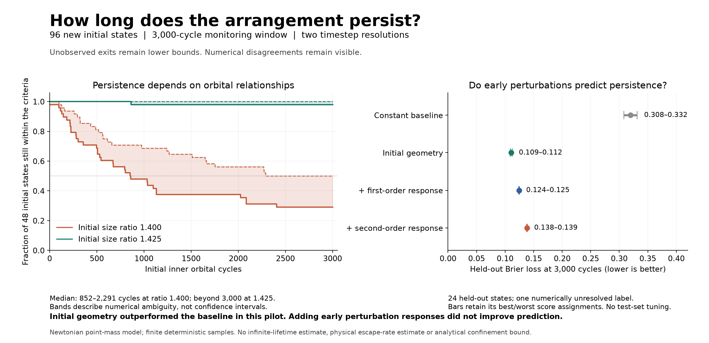

# Duration of relational stability and early prediction

**Date:** 30 October 2026  
**Status:** executed finite-duration numerical study and prospective computational test split; no certified physical lifetime bound  
**Investigation:** ROP-002, extending [relational orbital persistence](relational_orbital_persistence_v1.md)  
**Evidence:** [frozen configuration](../../../evidence/data/relational-orbital-duration-config-v1.json), [integrations](../../../evidence/data/relational-orbital-duration-runs-v1.json), [duration and prediction analysis](../../../evidence/data/relational-orbital-duration-analysis-v1.json), [independent fit check](../../../evidence/data/relational-orbital-duration-fit-check-v1.json), [verification](../../../evidence/data/relational-orbital-duration-verification-v1.json)

## Persistence duration is the primary observable

The quantity of interest is how many characteristic cycles a configuration retains its monitored relationships. Perturbation growth is a candidate predictor of that duration, rather than the definition of stability itself.

For a declared monitoring domain \(\mathcal B\), define

\[
N_{\rm exit}(x)=\frac{\inf\{t>0:\Phi_t(x)\notin\mathcal B\}}{T_{\rm initial\ inner}}.
\]

If no exit is observed by \(H\), the duration is recorded as exceeding the monitoring window. It is not assigned the value \(H\) or infinity. When accepted numerical resolutions disagree on exit time or on whether an exit occurs, that uncertainty is retained separately from administrative right censoring.

In a new 96-state sample monitored for 3,000 periods, nearby orbital-size slices have markedly different persistence. The initial size ratio 1.400 has a numerical median-duration range of approximately 852 to 2,291 periods. At ratio 1.425, the sampled median remains beyond the monitoring window. These are summaries of the declared numerical design, not confidence intervals or enclosures of exact trajectories.

The held-out prediction comparison also provides a useful negative result: initial size and phase improve on a constant baseline, while the added early first- and second-order response summaries worsen prediction. Accurate short-time perturbation prediction does not automatically supply an accurate lifetime predictor.



An [SVG figure](../../../evidence/figures/relational-orbital-duration-v1.svg) is available for export.

## Declared follow up and numerical uncertainty

The gravitational model and monitoring thresholds are those of the first investigation: planar masses \((1,0.001,0.001)\), aligned periapses, initial eccentricities 0.2, and termination at a close encounter, stellar approach or declared radial exit. The model is a dimensionless Newtonian point-mass calculation, not a fit to planetary observations.

The follow-up uses two initial outer-to-inner semimajor-axis ratios, 1.400 and 1.425, and 48 phases at each ratio. Phases are offset by half a grid cell from the original atlas, so they are new initial states. Each is integrated at 320 and 640 steps per initial inner period, up to 3,000 periods. The maximum sampled relative energy error must be at most \(10^{-5}\). As in the first atlas, the whole-run quality gate is applied conservatively to earlier horizons.

| Duration record | Count among 96 initial states | Meaning |
|---|---:|---|
| Administrative right censoring | 61 | Both resolutions survive through 3,000 periods |
| Observed exit range | 24 | Both resolutions reach a monitoring boundary; their exit times are retained |
| Resolution disagreement with censoring | 10 | One resolution exits and the other survives the window |
| Numerical quality unresolved | 1 | An energy gate fails; duration remains unclassified |

For each state, the range of observed durations is recorded with an open upper endpoint whenever an accepted run is censored. This range describes the calculations. It does not guarantee that the exact flow exits between the numerical endpoints.

An inverse duration is reported only as the reciprocal of this range. A survivor through \(H\) gives an inverse-duration upper limit of \(1/H\), not a measured zero. This reciprocal is not called a physical hazard or escape rate.

## Restricted duration avoids inventing an unobserved tail

The restricted mean duration uses

\[
\mu_H=\frac1n\sum_{i=1}^n\min(N_{{\rm exit},i},H)
=\int_0^H S_n(u)\,du.
\]

This quantity asks how much persistence is observed within the monitoring budget. Substituting \(H\) in the restricted quantity is legitimate even though it would be incorrect to treat \(H\) as the unrestricted lifetime of a censored state. With a common monitoring horizon, the empirical survival curve and restricted mean can be computed directly; no assumed constant hazard or tail model is needed.

Numerical ambiguity produces lower and upper empirical curves. At each time, the lower curve counts states surviving at both accepted resolutions. The upper curve also includes unresolved states. Restricted means and quantiles use the corresponding most- and least-persistent numerical assignments. These bands are not sampling confidence intervals.

| Initial size ratio | Restricted mean duration through 3,000 periods | Numerical median-duration summary |
|---|---:|---|
| 1.400 | 1,376 to 1,964 periods | 852 to 2,291 periods |
| 1.425 | 2,955 to 3,000 periods | Beyond 3,000 periods |
| Both slices combined | 2,166 to 2,482 periods | Beyond 3,000 periods |

The fifth-percentile duration is a useful conservative complement to the median: it asks when the earliest five percent of the declared sample can have exited. Its numerical range is 116 to 157 periods at size ratio 1.400, while it is still beyond the monitoring window at 1.425. This is a property of these 48 phase samples, not a 95-percent reliability guarantee for unsampled perturbations.

The [analysis record](../../../evidence/data/relational-orbital-duration-analysis-v1.json) also converts the original three 25-state neighbourhoods into duration summaries. The two wholly surviving neighbourhoods retain lower bounds beyond 1,000 periods. Their unrestricted means and medians are not inferred from that finite observation.

## A frozen test of early duration predictors

The phase-sector split, feature horizon, predictor families, penalty and primary score were specified before collecting the new durations. Six of eight phase sectors supply 72 training states; two sectors supply 24 test states. This split tests transfer to omitted phase sectors, rather than randomly interleaving close neighbours. The domain itself was chosen using the earlier exploratory atlas, so this is a prospective computational hold-out within a selected slice, not external astrophysical validation.

Features use only the first ten periods. The four fixed predictor families are:

1. A constant exit probability fitted on training states.
2. Initial geometry: logarithmic size ratio, sine of phase and cosine of phase.
3. Geometry plus the maximum norm of the first phase derivative of the three normalized distances during those ten periods.
4. Geometry and first response plus the corresponding maximum second-derivative norm.

The response norms use `log1p` transforms. Each horizon has a ridge logistic model with coefficient penalty one, training-only standardization and a weak intercept prior that keeps predictions finite when the training sample contains no observed exits. Unresolved training labels are omitted; that omission can be informative. Unresolved test labels remain in best/worst score bounds. The model and penalty are not tuned using the test results.

The target is exit by the declared horizon, conditional on reaching the ten-period feature window. The primary horizon is 3,000 periods. Brier loss is the average squared error of the predicted exit probability; lower is better.

| Predictor | Test Brier loss range at 3,000 periods |
|---|---:|
| Constant baseline | 0.308 to 0.332 |
| Initial geometry | 0.109 to 0.112 |
| Geometry plus first response | 0.124 to 0.125 |
| Geometry plus first and second responses | 0.138 to 0.139 |

One of the 24 primary test labels is numerically unresolved. The ranges retain both possible assignments for that label. They do not measure sampling uncertainty. The geometry model wins this particular test even under those assignments. The added response summaries do not improve it. With a small deterministic sample, this does not establish that perturbation information is generally useless; it rejects the claim that these chosen early scalar summaries already demonstrate added lifetime-prediction value.

The 100-, 300- and 1,000-period scores remain in the analysis record. The training sample has no resolved exits by 300 periods although the held-out phase sectors contain some. This is an explicit limitation on early-horizon transfer and a reason to retain every horizon instead of selecting a favourable result.

## What transfers to the corpus

The [dynatology investigation card](relational_orbital_persistence_v1.md#investigation-card) retains its carrier, dynamics and missing formation selector. Its detector coordinate now includes first-exit duration, censoring and horizon-specific prediction scores. Its scale coordinate measures duration in characteristic cycles. No new physical selection objective is introduced by fitting a predictor.

The result strengthens the corpus's distinction between local transport and viability. The same early mathematical response can be useful for describing nearby trajectories without being a sufficient statistic for how long their arrangements persist. Compressing the response into one norm may also erase mode direction, phase cancellation and later nonlinear transport. Those are candidate explanations for a future test, not conclusions established by the present comparison.

The next finite test is to derive a duration discriminator from the relational return map or its normal form, preserving the phase and directional information discarded by scalar norms. Its coefficients must be fixed on training cases and evaluated on a new duration sample. A useful lower bound must also control the nonlinear remainder; a logistic prediction is not such a bound.

## Reproduction

The duration integrations and analysis have no external JavaScript dependencies. Plotting uses the Python environment described in the first investigation.

```text
node verification/dynatology/run_relational_duration.mjs
node verification/dynatology/analyze_relational_duration.mjs
python verification/dynatology/check_duration_fits.py
python verification/dynatology/plot_relational_duration.py
node verification/dynatology/verify_relational_duration.mjs
```

The verifier tests censoring, numerical disagreement, the restricted-mean area identity, finite no-event logistic fits, score envelopes, training-only fitting and source hashes. An independent SciPy optimization reconstructs the primary fits from training data and agrees with their coefficients within \(1.4\times10^{-9}\). Its stopping diagnostics remain in the fit-check record. Independent adaptive integrations from the first study validate the shared dynamics on selected earlier examples; the new 96-state follow-up itself has two-resolution controls rather than an independent integration of every lifetime.

## Statistical references

- [CDC Kaplan–Meier guide](https://www.cdc.gov/epiinfo/user-guide/command-reference/analysis-commands/kmsurvival.html), for the distinction between observed events and censored follow-up. The present common-horizon deterministic sample does not require an inferred population survival model.
- [Scikit-learn model evaluation documentation](https://scikit-learn.org/stable/modules/model_evaluation.html), for the Brier scoring rule. The logistic fitting and uncertainty accounting here are independently implemented.
