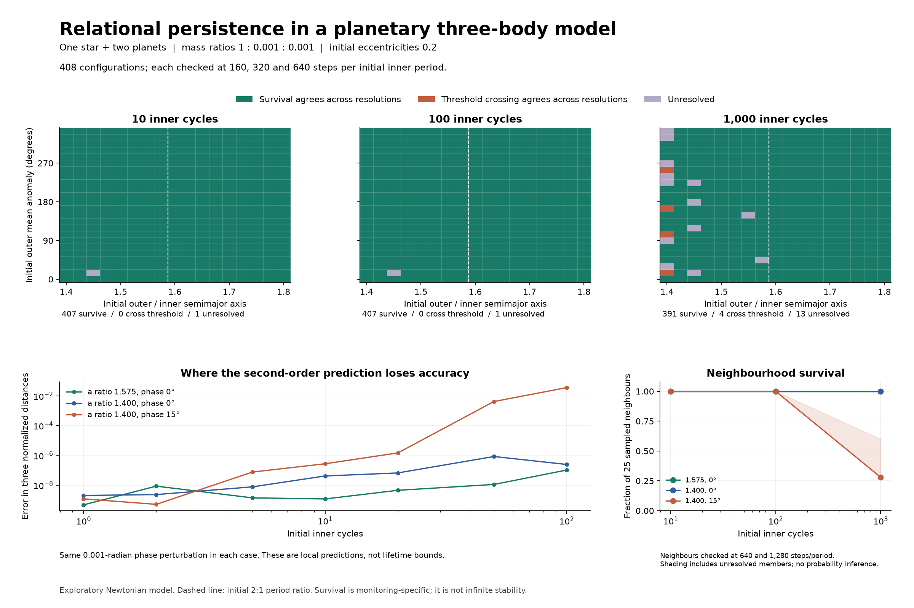

# Relational orbital persistence in a planetary three body model

**Date:** 30 October 2026  
**Status:** executed exploratory Newtonian calculation with numerical controls; no rigorous lifetime bound or quantum selection claim  
**Investigation:** ROP-001  
**Evidence:** [configuration](../../../evidence/data/relational-orbital-persistence-config-v1.json), [atlas](../../../evidence/data/relational-orbital-persistence-v1.json), [perturbation analysis](../../../evidence/data/relational-orbital-persistence-analysis-v1.json), [independent integrations](../../../evidence/data/relational-orbital-persistence-independent-v1.json), [numerical checks](../../../evidence/data/relational-orbital-persistence-verification-v1.json), [artifact certificate](../../../evidence/data/relational-orbital-persistence-evidence-check-v1.json)

## Question and result

Can nearby planetary configurations with the same masses and initial orbital sizes have different persistence because their orbital phases differ? Can first and second derivatives describe the initial growth of that difference, while longer integrations distinguish tolerant neighbourhoods from sensitive ones?

In the declared planar star–two-planet model, changing the outer mean anomaly from zero to fifteen degrees at the same initial semimajor-axis ratio gives a surviving case and a close-encounter case within 1,000 initial inner periods. Three symplectic timesteps and an independent adaptive integrator reproduce that difference in monitored outcome. The encounter time itself is sensitive to timestep. Neighbourhood samples retain the contrast without establishing a continuous invariant region.

This is an example of the corpus's distinction between admitted configurations, viable histories and robustness over a finite monitoring window. It supplies a conventional gravitational testbed for that distinction. It does not derive Solar System architecture, quantum selection, special cycle counts or a new force.



The [standalone SVG](../../../evidence/figures/relational-orbital-persistence-v1.svg) preserves labels for export. A green cell means agreement of sampled numerical outcomes, not a proof that every nearby state survives.

The [duration continuation](relational_orbital_duration_v1.md) makes first-exit duration the primary outcome, retains unobserved exits as lower bounds, and tests early response summaries on new configurations monitored for 3,000 periods. Its duration predictions are separate from the local trajectory predictions below.

## Declared system and monitoring rule

The masses are \((1,0.001,0.001)\), with \(G=1\), inner initial semimajor axis one, both initial eccentricities 0.2 and aligned periapses. Both planetary masses participate in all three gravitational pair interactions. Initial heliocentric two-body osculating elements are converted into barycentric positions and velocities. There is no force softening, external drive or damping.

The grid has 17 outer-to-inner initial semimajor-axis ratios from 1.4 to 1.8 and 24 outer mean anomalies, separated by fifteen degrees. The inner body starts at periapsis. The initial period-ratio range is approximately 1.66 to 2.41, including 2:1; no resonance libration criterion is used to identify a resonance mechanism.

Monitoring uses the initial inner Kepler period, rather than absolute years. A run terminates at the first detected occurrence of:

- planet–planet separation below one **initial mutual Hill radius**, \(R_H=[(m_1+m_2)/(3M)]^{1/3}(a_1+a_2)/2\);
- either star–planet separation above twenty initial inner semimajor axes; or
- either star–planet separation below 0.15 initial inner semimajor axes.

These are declared relational boundaries. A close encounter is not a physical collision, and radial exit is not proof of asymptotic ejection. Boundaries are checked at positive full-step endpoints; brief crossings can be missed. The different event handling of the independent adaptive solver provides a separate check on selected cases.

## Persistence depends on the monitoring window

Every grid point is integrated at 160, 320 and 640 steps per initial inner period. A run passes the numerical energy gate if the maximum sampled relative energy error is at most \(10^{-5}\). Energy is sampled once per initial inner period and at termination. A common monitored outcome at all three resolutions is recorded separately from an outcome disagreement.

| Monitoring horizon in initial inner periods | Surviving at all resolutions | Boundary crossed at all resolutions | Unresolved |
|---|---:|---:|---:|
| 10 | 407 | 0 | 1 |
| 100 | 407 | 0 | 1 |
| 1,000 | 391 | 4 | 13 |

The early unresolved cell is conservative: the whole-run energy gate is applied retrospectively to each horizon. At 1,000 periods, twelve cells disagree in outcome across resolutions and one fails the energy gate. Energy conservation alone would have missed the twelve disagreements. The atlas records them as unresolved instead of selecting a preferred trajectory.

The grid is exploratory and its spacings are not inferred from data. Agreement across three resolutions does not certify the nonlinear flow or every unsampled point. The 391 surviving cells are not an astrophysical survival probability.

## Phase sensitive persistence and sampled neighbourhoods

Three exemplars are chosen deterministically after the exploratory scan: the surviving point nearest the initial 2:1 ratio, then a surviving and failing phase at the same size ratio nearest 2:1 among ratios with both outcomes. This selection is not a held-out mechanism test.

| Initial size ratio | Outer mean anomaly | Symplectic outcome through 1,000 periods | Independent DOP853 outcome |
|---|---:|---|---|
| 1.575 | 0 degrees | Survives at all three resolutions | Survives |
| 1.400 | 0 degrees | Survives at all three resolutions | Survives |
| 1.400 | 15 degrees | Close encounter at all three resolutions | Close encounter at 878.748 periods |

For the fifteen-degree case, symplectic encounter times are 784.319, 452.316 and 878.942 periods as the timestep is refined. The agreement of the finest result with DOP853 supports the selected example; the earlier times demonstrate why a precise lifetime cannot be claimed from the coarse calculation. The independent solver uses relative tolerance \(10^{-11}\), absolute tolerance \(10^{-13}\), and has maximum sampled relative energy errors below \(1.6\times10^{-8}\) for these three controls.

Each exemplar also has 25 deterministic nearby initial states, varying outer phase within 0.01 radians and initial period ratio within a relative 0.001. Each neighbour is run at 640 and 1,280 steps per period.

| Neighbourhood centre | Survive at both resolutions | Encounter at both resolutions | Unresolved at 1,000 periods |
|---|---:|---:|---:|
| Size ratio 1.575 and phase 0 degrees | 25 | 0 | 0 |
| Size ratio 1.400 and phase 0 degrees | 25 | 0 | 0 |
| Size ratio 1.400 and phase 15 degrees | 7 | 10 | 8 |

All neighbours survive the first 100 periods. The later split gives a concrete instance of monitoring-dependent persistence and sensitivity to nearby relationships. Twenty-five samples do not certify an open region, establish a probability measure or test robustness to masses, inclination and external disturbances. Changing phase also changes the planet–planet contribution to total energy; these are matched osculating elements, not a fixed-total-energy comparison.

## First and second order relational predictions

The integrated state includes positions and velocities. The retained observables are the three normalized pair distances, \(d=(r_{01},r_{02},r_{12})/a_{1,0}\). Differentiating with respect to the initial outer mean anomaly gives

\[
d(t;\phi+\epsilon)=d(t;\phi)
+\epsilon\,\partial_\phi d(t;\phi)
+\frac{\epsilon^2}{2}\partial_\phi^2d(t;\phi)+O(\epsilon^3).
\]

The first and second variational equations are differentiated analytically through the force and through every drift and kick. They are derivatives of the discrete flow; timestep refinement and independent integrations test their connection to the continuous equations. The second initial derivative is included because the Kepler initial state depends nonlinearly on mean anomaly.

At the initial 2:1 ratio, phase 1.2 radians and a ten-period horizon, the within-integrator residual decreases by approximately four under halving \(\epsilon\) at first order and eight at second order until numerical error becomes significant. At \(\epsilon=0.001\), the independently integrated **change** in distances has first-order residual \(2.003\times10^{-6}\) and second-order residual \(4.332\times10^{-9}\), using derivatives at 1,280 steps per period: an improvement of approximately 462 times. Subtracting the independently integrated unperturbed state keeps baseline trajectory error distinct from perturbation error.

At the same size ratio 1.4, the zero-degree and fifteen-degree cases already differ sharply by 100 periods. For the same 0.001-radian perturbation, second-order distance residuals are approximately \(2.46\times10^{-7}\) and \(3.59\times10^{-2}\), respectively, at 640 steps per period. The latter is a loss of useful local predictive accuracy, not evidence that a higher-order collective restoring mechanism exists. A separate global confinement or escape argument is still required.

## Relation to the corpus carrier

The [locally invariant carrier](../admissibility/admissibility_123_locally_invariant_carrier_and_mirror_face_spine.md) asks what comparison survives transport. Here the concrete comparison is the canonical symplectic form, and the finite-time flow preserves it. A finite-difference check of the full twelve-dimensional map gives maximum entrywise defect in \(M^T\Omega M-\Omega\) of approximately \(1.3\times10^{-7}\), in mass-weighted canonical coordinates.

This is not yet the proposed four-dimensional reduced return map near a solved periodic orbit. Such a map would allow a direct application of the corpus's primitive two-form construction. The present carrier is the full barycentric planar state, and the three distances are detector observables. They discard absolute position, orientation and reflection information, and they do not retain velocities or a closed autonomous state description. No three-body triality, spinor sign or return order follows from the number of distance channels.

The [dynatology ontology](dynatology_00_ontology_and_scope.md) supplies the useful distinction between admissibility, viability, reachability and selection. This experiment measures sampled finite-window viability. Disk formation, capture and occupancy remain separate physical questions.

## Scale control

The same initial family is integrated at length scales one, ten and one hundred, with velocities scaled by \(\lambda^{-1/2}\) and elapsed times by \(\lambda^{3/2}\). After 100 inner periods, the maximum difference in normalized final distance vectors is approximately \(1.3\times10^{-11}\).

That reproduces Newtonian similarity at the tested resolutions. It is a conventional scale control, not evidence for quantum similarity. A quantum extension would need to account for the change of action relative to fixed \(\hbar\), and the [spectral boundary synthesis](../admissibility/admissibility_51_spectral_boundary_dynamics_free_bloch_efimov_casimir.md) does not identify its Efimov conditions with Newtonian planetary dynamics.

## Investigation card

| Coordinate | Declared role |
|---|---|
| X | Planar three-body positions and velocities; relational initial elements parameterize the tested slice |
| A | Noncollision Newtonian states with the declared monitoring boundaries |
| T | Autonomous gravitational flow; initial phase and size-ratio interventions |
| J | No formation objective or selection functional supplied |
| rho | Barycentric coordinate conversion; no physical coarse-graining of the evolution |
| L | Full pairwise Newtonian Hamiltonian dynamics |
| D | Three normalized pair distances, event flags, sampled conservation errors and finite-time derivatives |
| I | Energy, angular momentum, symplectic comparison and phase sensitivity |
| R | Exact Newtonian length/time similarity and numerical resolution refinement |
| Conventional comparator | Independently implemented DOP853 integrations of the same point-mass equations |
| Nuisance model | Timestep bias, event sampling, floating point accumulation and phase-sensitive trajectory divergence |
| Kill test | Phase contrast disappears under independent or refined integration, or claimed perturbation order fails its scaling test |
| Useful null | A reproducible conventional persistence atlas and limits on local perturbation prediction |
| Open coordinates | Certified region width, nonlinear lifetime bounds, four-dimensional return map, formation occupancy and quantum correction |

## Reproduction and verification

The JavaScript calculation has no external packages. The independent control requires NumPy and SciPy; figure rendering requires Matplotlib. The [Python requirements](../../../verification/dynatology/requirements-relational-persistence.txt) record the versions used. Python can use a normal environment or an installation supplied through `--dependency-path`.

```text
node verification/dynatology/verify_relational_persistence.mjs --record
node verification/dynatology/run_relational_persistence.mjs
node verification/dynatology/analyze_relational_persistence.mjs
python verification/dynatology/independent_relational_persistence.py
python verification/dynatology/plot_relational_persistence.py
node verification/dynatology/verify_relational_persistence_evidence.mjs
```

The numerical verifier checks fourth-order convergence against an exact two-body orbit, force derivatives, second-order Taylor scaling, time reversal, Newtonian similarity and symplecticity. The evidence verifier checks source hashes, horizon accounting, independent controls and the separation between numerical results and unproved claims. These checks establish reproducibility and numerical consistency of the stated experiment, not a theorem about all nearby trajectories.

## Next mathematical step

Use a solved periodic orbit and its symmetry-reduced return section to construct a four-dimensional symplectic map, compute a resonant normal form and bound its remainder. Test whether that bound predicts an independently sampled persistence neighbourhood. A local expansion that describes early divergence but cannot constrain later escape does not pass this gate. The numerical contrast here identifies useful examples; it does not yet predict their lifetime boundary.

## Primary sources

- Haruo Yoshida, [Construction of higher order symplectic integrators](https://doi.org/10.1016/0375-9601(90)90092-3), for the fourth-order composition used here.
- Hanno Rein and Daniel Tamayo, [Second-order variational equations for N-body simulations](https://arxiv.org/abs/1603.03424), for the established variational approach; this implementation is independent.
- Richard Montgomery, [The Three-body problem and the shape sphere](https://arxiv.org/abs/1402.0841), for the relational geometric formulation.
- [Sharp Nekhoroshev estimates for the three body problem around periodic orbits](https://arxiv.org/abs/1810.05987), for finite-time analytical stability estimates under stated assumptions; no bound from that paper is applied automatically here.
