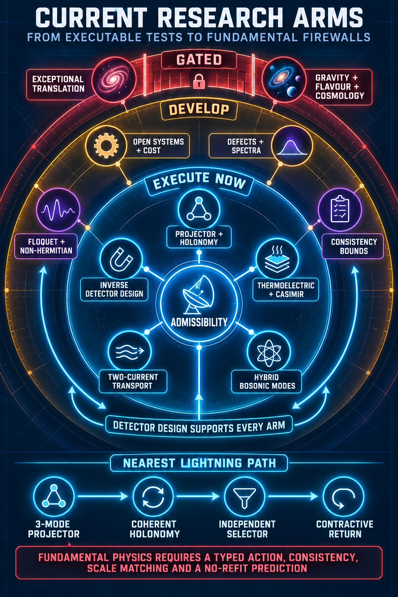

# Frontier physics target set v1

## Purpose

This is the corpus's consolidated frontier-physics lane. It turns the distributed admissibility work into a finite target set without pretending that every mapped item has the same evidential status. The machine-readable authority is [the target register](frontier_physics_target_register_v1.json); this document is its working view.

The target set is deliberately organized around **objects that could be calculated, built, measured or ruled out**. It is not a catalogue of interesting words. A target remains useful when its strongest interpretation fails: the `usefulNull` field in the register records the conventional scientific residue.

The target set is now complemented by the [detector and frontier atlas](detector_frontier_atlas_v1.md) and maintained [open-topic queue](open_topics_v1.md). Those artifacts make explicit which records can move each boundary and which questions remain live, gated or blocked.

## Core map

| ID | Frontier target | Workflow | Present boundary |
|---|---|---|---|
| [FPT-001](frontier_physics_target_assessments_v1.md#fpt-001) | Open-system contractive selection | execute now | Realize holonomy, monitoring, trajectories and a resource ledger in one physical platform without inserting the desired answer into the update law. |
| [FPT-002](frontier_physics_target_assessments_v1.md#fpt-002) | Inverse detector design and equivalence classes | execute now | Find the least-cost channel that separates the worst mechanism pair after detector folding and nuisance projection. |
| [FPT-003](frontier_physics_target_assessments_v1.md#fpt-003) | Same-carrier thermoelectric--Casimir closure | execute now | Close one causal material tensor across Hall, Seebeck, Nernst and boundary force/torque while beating ordinary backgrounds. |
| [FPT-004](frontier_physics_target_assessments_v1.md#fpt-004) | Two-current Planckian transport | execute now | Implement the continuity-derived periodic energy current before interpreting the particle/energy spectral rank. |
| [FPT-005](frontier_physics_target_assessments_v1.md#fpt-005) | Phonon, magnon and hybrid-mode laboratories | execute now | Resolve transported mode geometry, or adversarially separate it from damping and scattering. |
| [FPT-006](frontier_physics_target_assessments_v1.md#fpt-006) | Non-Hermitian and Floquet geometry | develop | Reconstruct coherent holonomy independently of gain/loss-conditioned dynamics. |
| [FPT-007](frontier_physics_target_assessments_v1.md#fpt-007) | Defects, walls and index-protected transport | develop | Identify what physical information, beyond protected mode count, a defect transports. |
| [FPT-008](frontier_physics_target_assessments_v1.md#fpt-008) | Hydrodynamic stress and constitutive cones | develop | Determine whether conservation leaves a multichannel response cone or a low-rank ray. |
| [FPT-009](frontier_physics_target_assessments_v1.md#fpt-009) | Quantum codes and synthetic gauge laboratories | develop | Derive allowed logical generators from a physical carrier rather than universal programmability. |
| [FPT-010](frontier_physics_target_assessments_v1.md#fpt-010) | Scattering, causality and positivity bounds | develop | Derive one admissibility inequality not reducible to standard unitarity, analyticity, causality or positivity. |
| [FPT-011](frontier_physics_target_assessments_v1.md#fpt-011) | Flavour, neutrino and CP geometry | hold | Derive a gauge-compatible path and overlap operator that predicts rather than imports Yukawa structure. |
| [FPT-012](frontier_physics_target_assessments_v1.md#fpt-012) | Gravity, torsion and rotating-source probes | hold | Conventional coefficient selection is exhausted; reopening requires one of two explicit new-physics gates. |
| [FPT-013](frontier_physics_target_assessments_v1.md#fpt-013) | Cosmology, relic defects and joined likelihoods | hold | Supply one covariant model with common parameters across expansion, perturbations, lensing and structure. |
| [FPT-014](frontier_physics_target_assessments_v1.md#fpt-014) | Constructive continuum and mass-gap control | hold | Replace finite scans with a regulator-, volume-, time- and operator-uniform estimate. |
| [FPT-015](frontier_physics_target_assessments_v1.md#fpt-015) | Thermodynamic cost of selection | develop now | Compare equilibrium, driven and measurement-conditioned selectors at matched apparent contraction. |
| [FPT-016](frontier_physics_target_assessments_v1.md#fpt-016) | Measurement backaction and records | develop now | Separate trajectory-conditioned selection, the unconditional channel and stored records. |
| [FPT-017](frontier_physics_target_assessments_v1.md#fpt-017) | Scale dependence and renormalization | develop | Construct a three-scale carrier and test which invariants survive coarse-graining without fitted basis maps. |
| [FPT-018](frontier_physics_target_assessments_v1.md#fpt-018) | Rare events, metastability and hysteresis | required diagnostic | Use rate functions, escape paths, waiting time and sweep rate to distinguish symmetry breaking from kinetic freezing. |
| [FPT-019](frontier_physics_target_assessments_v1.md#fpt-019) | Complexity and computational accessibility | audit column | Separate existence, preparation, sampling, detection and verification costs. |
| [FPT-020](frontier_physics_target_assessments_v1.md#fpt-020) | Causal spread and scrambling | required diagnostic | Compare selector mixing with calibrated propagation and resource bounds. |
| [FPT-021](frontier_physics_target_assessments_v1.md#fpt-021) | Disorder, glassy memory and robustness | audit column | Scale disorder, sample count and waiting time together on the same carrier. |
| [FPT-022](frontier_physics_target_assessments_v1.md#fpt-022) | Triality quotient scars and hidden-mode recovery | execute now | Realize a hub plus three cyclic outer modes with individual, summed and oriented contrast records. |

## Current execution queue

1. **Platform selector:** FPT-001 + FPT-015 + FPT-016. Put holonomy, monitoring, trajectory records and thermodynamic cost in one experiment.
2. **Detector-equivalence simulator:** FPT-002. Build the global forward model before optimizing a local sensitivity.
3. **Physical energy current:** FPT-004. Finish the production periodic operator and its convention tests.
4. **Co2MnGa closure:** FPT-003. Propagate one measured tensor into the differential Casimir observable.
5. **Quotient-scar platform:** FPT-005 + FPT-006 + FPT-022. Build the four-mode star and test dark-mode deletion, nonlinear memory and oriented recovery.

This queue is a workflow ranking, not an epistemic ranking. `execute_now` means that a sharp next calculation or experiment exists; it does not mean that the ambitious interpretation is likely to be true.

## Admission and failure rules

- **Standard or exact-local results** may establish mathematics, calibration or a platform-local physical statement.
- **Empirical neighbours** establish that a conventional laboratory realizes part of the required structure, not that the corpus interpretation follows.
- **Candidate bridges** require both endpoint definitions, a typed translation and a discriminator against the nearest conventional account.
- **Open targets** are questions, not claims.
- **Blocked or no-go targets** remain visible so effort is not silently recycled into an exhausted route.
- **Speculative zero-weight arcs** may suggest experiments or translations but contribute no evidence until they independently pass the ordinary gates.

“New physics” is not the reward for an anomaly. It becomes a live interpretation only after the observable, conventional envelope, nuisance model, independent replication and competing extensions have all been specified. For the exhausted torsion--flavour coefficient route, the register is stricter: only a new UV grading/nonrenormalization theorem or a computed interacting matter--gravity fixed point with a matched low-energy trajectory reopens the claim.

## How to use the lane

Start with an FPT identifier, follow its `sourceRefs` into the corpus, and use the [coverage map](frontier_physics_target_coverage_map_v1.md) to see which older branches, external phenomena, speculative arcs and execution packets touch it. Add new programme-level targets to the JSON first, preserving their gate, kill test and useful null; then update the readable maps and run the verifier.
