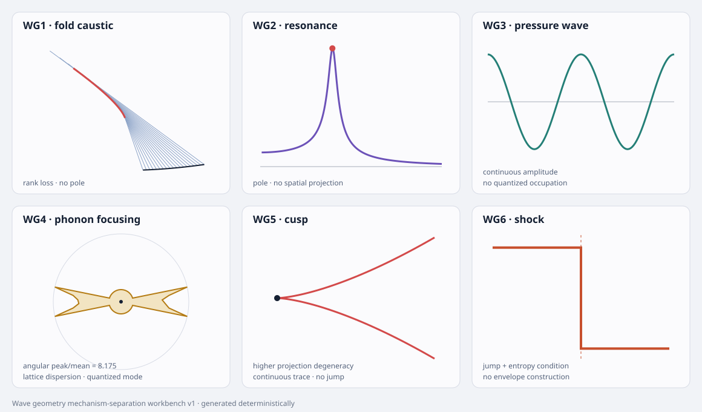

# Wave geometry mechanism-separation workbench v1

**Status:** executable neutral synthetic benchmark  
**Parent vocabulary:** [wave geometry, modes and singularities bridge](wave-geometry-mode-singularity-bridge-v1.md)  
**Evidence:** [deterministic workbench record](../../../evidence/data/wave-geometry-mechanism-workbench-v1.json)  
**Figure:** [six-case visual surface](../../../evidence/figures/wave-geometry-mechanism-workbench-v1.svg)

## Purpose

This workbench tests whether the corpus's typed distinctions survive execution. It does not ask whether several mechanisms can be made to look alike. It asks which additional observations prevent that silhouette-level ambiguity.

Every case uses the same algebraic interface:

\[
\boxed{\text{carrier}}
+\boxed{\text{generator}}
+\boxed{\text{propagator}}
+\boxed{\text{projection}}
+\boxed{\text{detector}}.
\]

A physical identification requires this chain. A curve, peak or sharp edge by itself is insufficient.

## Six matched cases

| case | positive mechanism | deliberately absent |
|---|---|---|
| WG1 | open-ray fold caustic | resonance, cavity, quantization and shock |
| WG2 | damped scalar resonance | rays, spatial projection and caustic |
| WG3 | classical continuum pressure wave | lattice and phonon quantization |
| WG4 | anisotropic lattice phonon focusing | shock and any cavity-resonance claim |
| WG5 | semicubical cusp | field jump, entropy condition and shock |
| WG6 | Burgers Riemann shock | envelope family, cusp construction and resonance |

### WG1 — caustic without resonance

Begin with the open source curve

\[
r_0(u)=(u,-a\cos u),
\qquad a=0.55,
\]

and propagate its unit normals:

\[
q(u,s)=r_0(u)+s n(u).
\]

The projection loses rank where

\[
\det(\partial_uq,\partial_sq)=0.
\]

For a normal family this occurs at the radius of curvature \(s=1/\kappa(u)\). The benchmark restricts \(u\) to a monotone-curvature interval, producing a regular fold caustic rather than a cusp. There is no temporal response function or resonant pole in this model.

### WG2 — resonance without caustic

The spatially zero-dimensional oscillator has

\[
\chi_R(\omega)=
{1\over\omega_0^2-\omega^2-i\gamma\omega},
\qquad
\omega_0=1,
\quad
\gamma=0.12.
\]

It has a finite-width gain peak and a lower-half-plane pole. It has no ray family or spatial projection from which a caustic could arise.

### WG3 — pressure wave without phonon quantization

The classical continuum field is

\[
p(x,t)=A\cos(kx-\omega t),
\qquad
\omega=ck.
\]

The benchmark records ordinary continuous pressure amplitude. It introduces no lattice, creation operator, occupation number or quantum normalization. Calling this field a phonon would add structure not present in the model.

### WG4 — phonon focusing

The anisotropic square lattice uses

\[
\omega^2(k)=4\left[
C_x\sin^2{k_x\over2}
+C_y\sin^2{k_y\over2}
\right],
\qquad C_x=1,
\quad C_y=0.22.
\]

On a fixed-frequency shell the group velocity is

\[
v_g=\nabla_k\omega.
\]

The generated angular histogram shows a peak-to-mean concentration greater than the preregistered \(1.5\) threshold. This is directional focusing of lattice modes. It is not called a cavity resonance because no driven boundary response was supplied.

### WG5 — cusp without shock

The canonical semicubical curve

\[
(x,y)=(u^2,u^3)
\]

has a pointed projection singularity at \(u=0\). The trace is continuous and carries no left/right field states, Rankine–Hugoniot jump or entropy condition.

### WG6 — shock without cusp construction

For Burgers' conservation law

\[
u_t+\left({u^2\over2}\right)_x=0,
\]

take Riemann data \(u_L=1\), \(u_R=0\). The entropy shock travels at

\[
s={f(u_L)-f(u_R)\over u_L-u_R}={1\over2},
\]

and satisfies \(u_L>s>u_R\). This is a discontinuity selected by conservation and entropy. It requires no envelope or higher projection degeneracy.

## Inverse semantic-decompiler check

The workbench removes the case names and exposes only typed feature envelopes: spatial propagation, projection rank loss, higher degeneracy, retarded pole, classical constitutive field, periodic carrier, quantization, anisotropic group velocity, field jump and entropy condition.

The deterministic classifier recovers all six mechanisms. That perfect score has a narrow meaning: the typing rules are sufficient on complete noiseless synthetic records. It is not evidence that real observations will expose every required field. A later robustness tranche must mask readers, add noise and quantify equivalence classes rather than force a label.

## Visual surface

The surface keeps the distinctions visible:

- WG1 displays rays and their fold locus;
- WG2 displays a response peak;
- WG3 displays a continuous pressure phase;
- WG4 displays the angular group-velocity concentration;
- WG5 displays a continuous cusp;
- WG6 displays a discontinuous entropy shock.

## Result

The carrier–generator–propagator–projection–detector schema separates all six mechanisms when its fields are observed. It also reveals the honest next difficulty: missing or noisy fields can collapse distinct mechanisms into the same observational class.

## Application boundary

The workbench is neutral. It provides no evidence for MOND, gravitational retardation, M44 or extra dimensions. A later application must supply its own governing operator, parameters, likelihood, controls and detector model before reusing any case.

## Next gate

Run a masked-reader tournament:

1. remove one or more typed fields;
2. add calibrated noise and finite resolution;
3. compute which mechanisms remain distinguishable;
4. report equivalence classes and the cheapest separating measurement;
5. refuse classification where the observation does not identify the mechanism.
