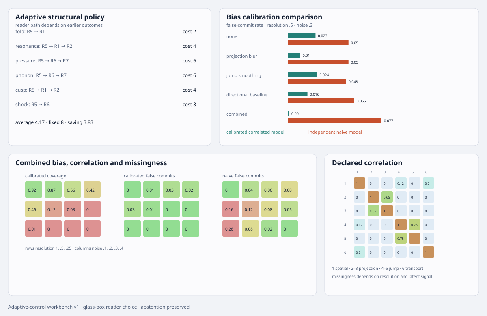

# Wave mechanism adaptive-control workbench v1

**Status:** deterministic adaptive measurement and misspecification benchmark  
**Parent:** [reader-ablation and minimal-separator workbench](wave-mechanism-reader-ablation-v1.md)  
**Evidence:** [adaptive-control record](../../../evidence/data/wave-mechanism-adaptive-control-v1.json)  
**Figure:** [adaptive policy and robustness surface](../../../evidence/figures/wave-mechanism-adaptive-control-v1.svg)

## Purpose

The fixed reader tournament found complete separating sets. A fixed set still measures every selected channel for every case. This tranche asks whether the next measurement can depend on what earlier measurements actually showed, and whether that advantage survives a more hostile observation model.

The workbench remains non-LLM. Every choice is reproduced from candidate sets, reader partitions, acquisition costs and declared likelihoods.

## Adaptive structural policy

At any step, let \(C\) be the mechanisms still compatible with the observations. For every unmeasured reader \(r\), partition \(C\) by its possible reader outcomes. With a uniform prior inside \(C\), compute

\[
I(r;C)=\log_2|C|-
\sum_o { |C_o|\over |C|}\log_2|C_o|.
\]

The policy selects the reader maximizing information gain per synthetic acquisition cost,

\[
r^*=\arg\max_r {I(r;C)\over c_r},
\]

then records the observed outcome, updates \(C\), and repeats until the candidate set is a singleton or no reader provides information.

The saved trace includes, for every ground-truth mechanism:

- candidate set before each measurement;
- selected reader and cost;
- observed bit signature;
- information gain and gain per cost;
- candidate set after the observation;
- cumulative cost and final identification.

This is adaptive because different outcomes follow different reader paths. It is not a static ordering with early exit hidden behind adaptive language.

## Hostile observation model

The primary fixed separator expands into six scalar dimensions:

1. spatial propagation;
2. projection rank loss;
3. higher projection degeneracy;
4. field jump;
5. entropy condition;
6. anisotropic group velocity.

The benchmark declares correlated Gaussian noise, including correlation \(0.65\) between the projection fields and \(0.75\) between jump and entropy fields. It also introduces four systematic regimes in addition to the correlation-only control:

- projection blur;
- jump smoothing;
- a false directional baseline;
- all three together.

Missingness is not at random. Its probability rises as resolution falls and is slightly higher when the latent feature is positive:

\[
p_{\rm miss}=0.04+0.28(1-r)+0.09I_{\rm positive},
\]

capped at \(0.75\).

This is a synthetic stress law, not an empirical instrument model.

## Calibrated versus naive inference

Two models see the same generated records:

1. **Calibrated:** uses the declared covariance, systematic means and missingness likelihood.
2. **Independent naive:** assumes independent noise, zero bias and ignorable missingness.

Both retain the posterior commitment gate of \(0.8\). Coverage, selective accuracy, false commitments and abstention remain separate. The comparison therefore exposes cases where a simpler model looks decisive only because it ignores the mechanism that damaged the observation.

## Result

The adaptive structural policy identifies all six synthetic mechanisms while reducing average acquisition cost relative to the fixed complete reader set. The saving is outcome-dependent and the maximum path cost remains visible.

Under correlated noise, systematic bias and missing-not-at-random dropout, calibrated and naive results diverge. The workbench does not compress that divergence into one accuracy score: loss of coverage, false commitment and abstention remain inspectable at every scenario, resolution and noise level.

## Glass-box properties

- reader choice traces are saved;
- candidate sets and bit outcomes are exact;
- costs and gain calculations are explicit;
- covariance and systematic biases are serialized;
- missing-reader masks contribute to the calibrated likelihood;
- abstention is an output, not an exception;
- no LLM is required for the loop.

## Boundary

This is still a neutral synthetic control. It does not establish that the chosen priors, costs, covariance, biases or dropout law describe any physical instrument. A real application must replace each with immutable observations and a calibrated carrier-specific forward model.

## Next gate

Instantiate the adaptive policy on one real acoustic or elastic dataset. Preserve raw observations, calibration receipts and the exact reader trace. Compare the deterministic candidate-set output with an LLM-assisted explanation, while forbidding the explanation layer from narrowing an equivalence class or overriding abstention.
