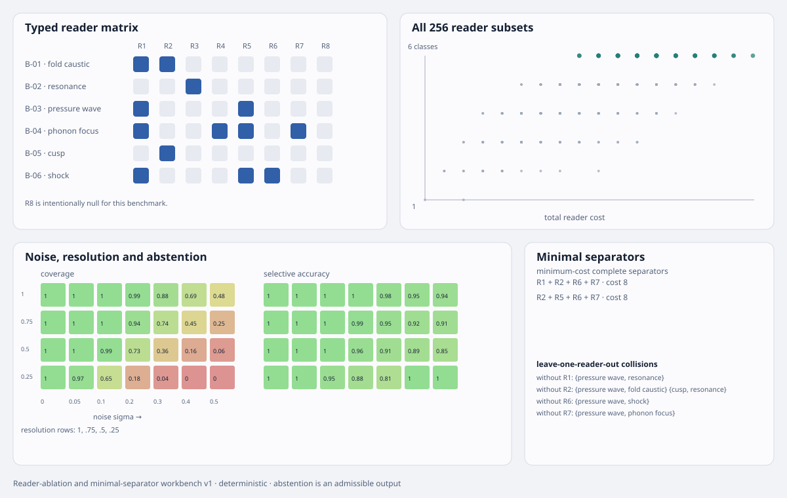

# Wave mechanism reader-ablation and minimal-separator workbench v1

**Status:** deterministic structural and noisy-observation tournament  
**Parent:** [wave geometry mechanism-separation workbench](wave-geometry-mechanism-workbench-v1.md)  
**Evidence:** [reader-ablation record](../../../evidence/data/wave-mechanism-reader-ablation-v1.json)  
**Figure:** [equivalence and robustness surface](../../../evidence/figures/wave-mechanism-reader-ablation-v1.svg)

## Question

The parent workbench separates six mechanisms when every typed feature is visible. This tranche asks the realistic inverse question:

> Which distinctions survive when readers are missing, noisy or resolution-limited, and what is the cheapest additional measurement that restores identification?

The system is not permitted to guess a singleton when the observation identifies only a set.

## Readers

| ID | reader | cost | recorded fields |
|---|---|---:|---|
| R1 | spatial support | 1 | spatial propagation |
| R2 | projection geometry | 2 | rank loss and higher degeneracy |
| R3 | response spectrum | 2 | retarded pole |
| R4 | quantization and periodicity | 4 | quantized occupation and periodic carrier |
| R5 | constitutive-field typing | 1 | classical constitutive field |
| R6 | jump and entropy | 2 | field discontinuity and entropy condition |
| R7 | directional transport | 3 | anisotropic group velocity |
| R8 | coherent phase | 2 | coherent phase structure |

Costs are synthetic relative acquisition costs, not monetary forecasts. R8 is intentionally null for the current six cases. This tests whether the optimizer correctly refuses a sophisticated-sounding reader that carries no discriminating information.

## Exact structural tournament

All \(2^8=256\) reader subsets are enumerated. For each subset, mechanisms with identical projected feature signatures are placed in one equivalence class.

The admissible output is therefore

\[
\text{observation}
\longmapsto
\{\text{all mechanisms consistent with it}\},
\]

not an obligatory single label.

The evidence records:

- the complete partition for every reader subset;
- every fully separating subset;
- all minimum-cost complete separators;
- leave-one-reader-out collisions;
- the cheapest additions that restore complete separation;
- readers that are null on the current candidate family.

No single reader distinguishes all six mechanisms. The minimum separator is a composition of typed readers, which is exactly the point of the carrier–generator–propagator–projection–detector schema.

## Noise and resolution tournament

The primary minimum-cost separator is then tested over

\[
\sigma\in\{0,.05,.1,.2,.3,.4,.5\}
\]

and relative resolutions

\[
r\in\{1,.75,.5,.25\}.
\]

Each mechanism receives 400 deterministic pseudo-random trials at every grid point. Reader signals are attenuated according to declared resolution sensitivities and receive independent Gaussian noise. Classification uses calibrated prototypes at the same resolution.

A posterior gate of \(0.8\) separates commitment from abstention. Four quantities remain distinct:

- **coverage:** committed trials divided by all trials;
- **selective accuracy:** correct trials divided by committed trials;
- **false-commit rate:** incorrect commitments divided by all trials;
- **abstention rate:** withheld decisions divided by all trials.

This prevents an apparently high accuracy from hiding either universal abstention or reckless guessing.

## Result

The exact tournament converts missing readers into explicit equivalence classes. The noisy tournament shows the expected control behaviour: increasing noise and reducing resolution lower confident coverage, while the abstention gate keeps uncertainty visible rather than silently converting it into a label.

The perfect zero-noise endpoint is a construction check. It does not establish that real instruments provide independent Gaussian errors, calibrated transfer functions or complete feature fields.

## Glass-box guarantees

Every plotted cell drills down to:

1. the selected reader IDs;
2. their feature fields and synthetic costs;
3. the projected mechanism signatures;
4. the resulting equivalence partition;
5. the declared noise and resolution values;
6. commitment, correctness and abstention counts.

The null coherent-phase reader remains visible instead of being deleted after it fails to help. A later carrier may make it informative.

## Application boundary

This remains a neutral synthetic control. It does not establish empirical identifiability for MOND, gravitational retardation, M44, extra dimensions, acoustics or condensed matter. Applications must replace the synthetic feature and noise models with calibrated forward operators and likelihoods.

## Next gate

1. introduce correlated noise and systematic reader bias;
2. model reader failures and missing-not-at-random data;
3. test adaptive measurement selection rather than a fixed reader set;
4. instantiate one real carrier while preserving the same abstention semantics;
5. compare the deterministic separator with an LLM-assisted interpretation without allowing the LLM to override equivalence classes.
