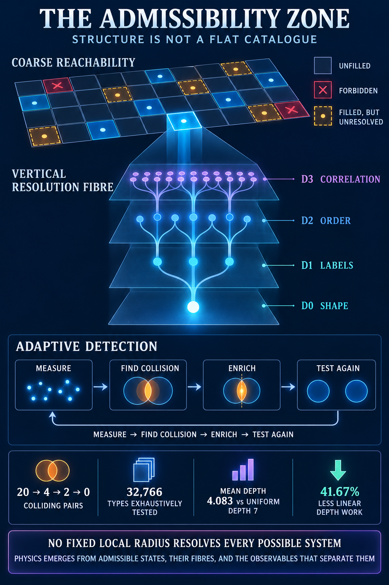

# Frontier Wave 7.35: The Adaptive-Depth Census and Detector Cost Curve

**Date:** 24 October 2026  
**Status:** exhaustive finite-family census; adaptive stopping advantage measured  
**Ledger:** [adaptive-depth census v1](monster_lean_adaptive_depth_census_v1.json)  
**Generator:** [census generator](../../../../verification/generate/generate_monster_lean_adaptive_depth_census.mjs)  
**Verifier:** [census verifier](../../../../verification/verify/verify_monster_lean_adaptive_depth_census.mjs)

## Result

All 32,766 binary-labelled right-associated Lean arrow types of lengths one through fourteen were exhaustively partitioned by the bounded detector of wave 7.34. The smallest radius giving global injectivity at each length was

\[
1,1,1,2,2,3,3,4,4,5,5,6,6,7,
\]

which equals \(\max(1,\lfloor n/2\rfloor)\) throughout the tested range. This is a census observation, not an all-length theorem.

At length fourteen, a uniform globally injective pass requires radius seven. Adaptive stopping, however, has mean radius only

\[
4.0830078125,
\]

reducing linear depth work by 41.6713% relative to applying radius seven to every object.

## 1. The finite atlas

Each bit word of length \(n\) encodes a valid closed type

\[
T(b_1)\to\cdots\to T(b_n)\to\mathrm{Unit},
\qquad T(0)=\mathrm{Nat},\quad T(1)=\mathrm{Bool}.
\]

At fixed length, every one of the \(2^n\) types has the same raw constructor-count Monster address. A leaf-label bag separates only by Hamming weight. The bounded detector then adds prefix and suffix anchors plus all labelled window decks through the chosen radius.

The length-fourteen refinement is:

| Radius | Distinct signatures | Collision pairs | Largest fibre | Individually unique objects |
|---:|---:|---:|---:|---:|
| 1 | 184 | 1,754,574 | 400 | 32 |
| 2 | 1,678 | 152,644 | 60 | 276 |
| 3 | 7,692 | 17,506 | 12 | 3,272 |
| 4 | 14,078 | 2,662 | 6 | 12,032 |
| 5 | 16,102 | 296 | 4 | 15,832 |
| 6 | 16,366 | 18 | 2 | 16,348 |
| 7 | 16,384 | 0 | 1 | 16,384 |

The leaf-label bag alone has 20,050,108 colliding pairs at this length. Local assembly data therefore does almost all of the separating work.

## 2. Adaptive stopping distribution

The numbers becoming unique for the first time at radii one through seven are

\[
(32, 244, 2996, 8760, 3800, 516, 36).
\]

Thus 73.4375% of the corpus is individually resolved by radius four, 96.6309% by radius five, and 99.7803% by radius six. Only 36 of 16,384 objects require the universal radius-seven ceiling.

This resolves the apparent tension between waves 7.34 and 7.35:

- the no-go says no fixed shallow radius is universally sufficient over unbounded expressions;
- the census says most members of a bounded corpus can stop well before its worst-case radius.

Worst-case depth controls correctness. The distribution of stopping depths controls cost.

## 3. Detector architecture implied by the census

The atlas should store a refinement tree rather than one flat identifier:

1. canonical Monster address as the base cell;
2. stable leaf-label scar;
3. radius-one ordered neighbourhood digest;
4. successively deeper digests only for fibres of size greater than one;
5. full canonical hash for any fibre that reaches the declared resource ceiling unresolved.

Each object can carry its **separation depth**: the first radius at which its fibre becomes a singleton relative to the declared corpus. That number is corpus-relative and can increase when new objects arrive. It is therefore evidence about current observability, not an intrinsic semantic invariant.

## 4. Implication for the frontier map

The finite Monster box is only the horizontal base. Above each occupied address sits a resolution tower whose levels are detector depths and whose fibres split as information is restored. The resulting admissibility geometry has two independent coordinates:

\[
(\text{coarse reachability},\ \text{observational resolution}).
\]

A cell can be filled horizontally while unresolved vertically. Conversely, a singleton at the present detector depth can become a collision when the corpus expands. The atlas must therefore record both occupancy and the detector/corpus under which purity was measured.

## Boundary

The census is exhaustive only for the declared 32,766 synthetic type chains. It has not measured real declaration dependencies, binders, applications, universes or the reported 1,979-declaration dataset. The observed half-length injective-radius pattern is not promoted beyond \(n\le14\). The robust conclusion is narrower: adaptive depth can retain a worst-case separation guarantee on a finite corpus while spending substantially less average detector depth.
