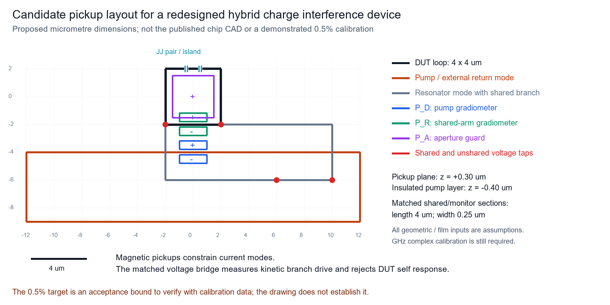

# Inductive strength and independent local drive measurements

**Date:** 8 November 2026  
**Status:** prospective measurement protocol and conditional instrument models; no new device measurements  
**Parent:** [programme record](README.md)  
**Evidence:** [ratio tests](../../../evidence/data/hcq-lever-arm-ratio-test-v1.json), [paired Rabi protocol](../../../evidence/data/hcq-isofrequency-rabi-protocol-v1.json), [independent flux witness](../../../evidence/data/hcq-independent-local-flux-witness-v1.json), [pickup geometry](../../../evidence/data/hcq-screening-pickup-geometry-v1.json)

## A ratio removes a scale only under a factorization condition

If \(d(\Phi)=\eta\bar d(\Phi)\) with one common scalar \(\eta\), transition-strength ratios remove \(\eta^2\). A leading single-channel Casimir–Polder force also factors that way. An unknown frequency-dependent source weighting remains inside the force integral; multiple channels need not share one factor.

For a flux-independent force background \(B\), a raw ratio does not remove \(B\), but

\[
\frac{F(\Phi)-F(\Phi_0)}{F(\Phi_1)-F(\Phi_0)}
\]

removes both \(B\) and a common multiplicative factor in a linear single-channel approximation. This is not an unrestricted identity for a nonlinear multiple-scattering determinant.

The source audit constructs two isospectral charge-source actions with different normalized electric strengths. Their contacts restore static-response equality, while finite-frequency responses remain different. Spectral agreement therefore does not determine an arbitrary optical source or its force ratio.

## A paired-frequency test of the declared current vertex

For the minimal two-state model, \(I=-\partial_\Phi H=I_p\sigma_z\). A fixed-charge target with minimum frequency \(f_{\min}\), detuned in flux to frequency \(f\), has transition magnitude \(I_p f_{\min}/f\).

A reference can be parked at flux degeneracy while its gate is adjusted to the same \(f\). Its predicted magnitude is \(I_p\). With the same local pump field,

\[
\left|\frac{\Omega_{\rm target}}{\Omega_{\rm reference}}\right|^2
=\left(\frac{f_{\min}}{f}\right)^2.
\]

This tests the declared current vertex and reference model; it is not a model-independent reconstruction of every source operator. The reference must lie in the gate-tunable gap range. A lower-gap target supplies a substantial interval, whereas the published high-gap operating point has little headroom under this construction.

For the frozen illustrative target \(Q/e=0.5\), the minimum gap is 1.832 GHz. Matched carriers of 2.0, 2.2 and 2.4 GHz give predicted squared-rate ratios 0.839, 0.694 and 0.583. The [working-point record](../../../evidence/data/hcq-isofrequency-rabi-protocol-v1.json) supplies the corresponding gate and flux coordinates. These are proposed acquisitions, not records extracted from the single public Rabi trace.

Use two different diagonal preparations, subtract the measured traces, and normalize by their zero-duration difference. Unknown nonzero population contrast and stable linear readout gain cancel. For an ideal resonant Markov pulse,

\[
n(t)=e^{-\gamma t}[\cos(\omega_dt)+c\sin(\omega_dt)],
\qquad \Omega^2=\omega_d^2(1+c^2).
\]

Extracting \(\omega_d\) without the damping-shape correction is insufficient. Estimating measured rates and decay shapes does not authorize changing the predicted current ratios. Pulse onset, detuning, leakage, parity switching and the mapping to readout must be controlled. Simulated affine readouts and Bloch dynamics validate the cancellation algebra, not experimental precision.

## An independent field witness avoids circular calibration

A pickup or microwave flux transducer can observe the source field without assuming the transition strength under test. An [embedded SQUID flux transducer](https://arxiv.org/abs/1808.09612) is a primary experimental precedent; its nominal bandwidth is not a precision certificate for this proposed GHz experiment.

For complex sensor sideband \(B\) and probe carrier \(C\), an interleaved small-signal cross-ratio

\[
R_s=\frac{B_t C_r}{B_r C_t}
\]

removes common carrier/sideband response factors if the sensor remains stable. It measures sensor flux, which equals device drive only after a coupling/coverage argument.

If the current modes are \(\mathbf i\), sensors record \(\mathbf y=K\mathbf i\), and the desired drive is \(\mathbf m^T\mathbf i\), then reconstruction requires \(\mathbf m^T\) to lie in the row span of \(K\) on the allowed mode subspace. A synthetic blind-mode example retains identical single-pickup readings while the device flux changes by 10%. A second independent mode observation detects that change. Small residuals cannot bound modes that all sensors miss.

## The shared NbN branch requires a circuit drive coordinate

The kinetic contribution is important for a shared superconducting branch. With mesh-to-branch incidence \(B\),

\[
U_{\rm ind}=\tfrac12\mathbf i^T B^T(L_{\rm geo}+L_{\rm kin})B\mathbf i.
\]

The off-diagonal shared-branch coupling is not necessarily determined by aperture magnetic flux alone. The reconstruction must separate the externally supplied circuit drive from the DUT self-current already represented in its Hamiltonian. Otherwise the witness can absorb the physical response under test.

The [candidate layout](../../../evidence/data/hcq-screening-pickup-geometry-v1.svg) contains three magnetic channels and differential voltage pickups on matched shared and unshared branches. The unshared monitor isolates the resonator-current coordinate. It substantially improves conditioning in the stated thin-wire/lumped surrogate compared with subtracting the large self-current from magnetic channels alone.

All dimensions, film inputs, layer assignments and tap targets are design assumptions. The actual layout, London/Maxwell sheet currents, kinetic impedance distribution, receiver covariance and sensor backaction remain unmeasured. The surrogate spans three selected current modes; that is not proof that it contains every mode of the real chip.

## The 0.5% acceptance contract

Independently calibrate the complex reconstruction, sensor-gain ratios, shared/unshared impedance ratio and self-current null before the Rabi comparison. Use held-out current injections and field patterns to test coverage. Keep correlations when propagating the common reconstruction coefficients between target/reference blocks.

The acceptance rule is

\[
\big||\hat r|-1\big|+U_{95}+b_{\rm bounded}\le0.005.
\]

The proposed allocations reserve 0.4% for statistical/systematic bounds and 0.1% for servo residual. They are requirements to demonstrate, not achieved errors. If the measured fields are unequal, the independently recorded ratio can instead correct the squared Rabi-rate ratio by \(|r|^2\). An injected strength-law violation survives that correction in the numerical witness; the calibration does not force a pass.

The next discriminator is a frozen measured GHz calibration packet and new paired Rabi acquisitions. No local-drive equality, selector-specific mechanism or Casimir force is experimentally admitted by the instrument sketches.
